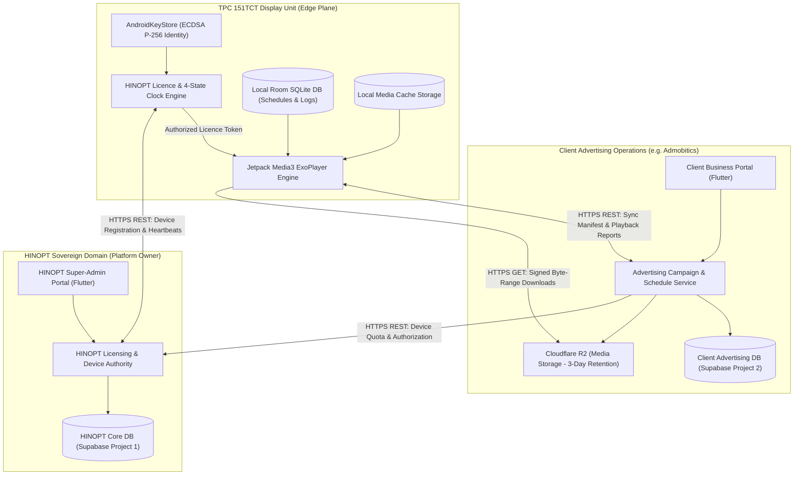

# HINOPT Ads Display Software

Enterprise-grade, specification-driven Digital Signage and Advertising Management Platform engineered for high-reliability offline-first edge playback, sovereign cryptographic licensing, and multi-tenant advertising operations.

---

## 1. System Overview & Hierarchy

**HINOPT Ads Display Software** is architected around a strict B2B multi-tenant operational model:

1. **HINOPT (Platform Owner):** HINOPT owns the software, master licensing authority, hardware cryptographic enrollment, and global product governance.
2. **Client Advertising Companies (e.g. Admobitics):** Commercial clients who purchase software licences from HINOPT. Admobitics is an advertising company and a customer of HINOPT. Each client manages their own advertisers, campaigns, media, and screens through their dedicated Client Portal.
3. **Zero Demo Data Invariant:** Out-of-the-box, the software contains **zero demo clients, zero demo screens, and zero demo campaigns**. The HINOPT Super-Admin dashboard is completely clean; screens and clients appear strictly when physically registered.



---

## 2. Core Subsystems

| Component | Target Runtime / Stack | Responsibility |
| :--- | :--- | :--- |
| **Android Display Player** (`apps/android-player/`) | Kotlin, Jetpack Media3, Android SDK 29, Room, WorkManager, Android Keystore | Hardware-accelerated 1080p video playback, offline 4-state time machine, clock rollback protection, local schedule evaluation. |
| **HINOPT Super-Admin Portal** (`apps/hinopt-admin/`) | Flutter (Web/Desktop) | Master licensing, registering client tenants (e.g. Admobitics), screen authorization, device revocation, platform telemetry. |
| **Client Business Portal** (`apps/business-admin/`) | Flutter (Web/Desktop) | Client portal for ad operations: campaigns, day-parting, screen targeting, creative upload, proof-of-play analytics. |
| **Licensing Service** (`backend/licensing-service/`) | Node.js, TypeScript, Supabase PostgreSQL (`hinopt-core`) | Sovereign device registry, Ed25519 licence signing, device heartbeat ingestion. |
| **Advertising Service** (`backend/advertising-service/`) | Node.js, TypeScript, Supabase PostgreSQL (`client-ads`) | Campaign scheduling, playlist generation, sync-manifest generation, proof-of-play ingestion. |
| **Media Service** (`backend/media-service/`) | Node.js, TypeScript, Cloudflare R2 | Pre-signed upload coordination, video validation, automated deletion (End Date + 3 Days). |

---

## 3. Repository Directory Structure

```
.
├── README.md                       # Master project overview & hierarchy
├── PROJECT.md                      # Official project charter, scope, and governance
├── CONTRIBUTING.md                 # Engineering guidelines, conventional commits, SDD rules
├── CHANGELOG.md                    # Formal semantic version release log
├── LICENSE                         # Proprietary license terms
│
├── docs/                           # Living technical documentation
│   ├── product/                    # Product requirements, personas, workflows
│   ├── architecture/               # System architecture, C4 diagrams, Revision 3.0 baseline
│   ├── engineering/                # Coding standards, linters, CI/CD specifications
│   ├── security/                   # STRIDE threat model, key management, offline time security
│   ├── database/                   # Supabase schemas, ERDs, RLS policies, migrations
│   ├── api/                        # OpenAPI contracts and communication protocols
│   └── deployment/                 # Deployment architecture, environment configs
│
├── specifications/                 # Formal engineering specifications (SDD)
│   ├── requirements/               # PRD-001 through PRD-004
│   ├── features/                   # FEAT-001 through FEAT-003
│   ├── decisions/                  # Architecture Decision Records (ADR-001 through ADR-009)
│   └── acceptance-tests/           # Gherkin/Cucumber acceptance criteria
│
├── apps/                           # Application frontends
│   ├── android-player/             # Kotlin/Media3 Android kiosk display player
│   ├── business-admin/             # Flutter client operations portal (e.g. for Admobitics)
│   └── hinopt-admin/               # Flutter super-admin portal for HINOPT
│
├── backend/                        # Backend microservices (Node.js + TypeScript)
│   ├── licensing-service/          # HINOPT sovereign licensing & device authority
│   ├── advertising-service/        # Client campaign scheduling & playback analytics
│   └── media-service/              # Cloudflare R2 ingestion, pre-signed URLs, cleanup
│
├── infrastructure/                 # Infrastructure as Code & Database Migrations
│   ├── supabase/                   # Supabase migrations for hinopt-core and client-ads
│   ├── storage/                    # Cloudflare R2 lifecycle rules and IAM policies
│   └── deployment/                 # Docker, orchestration, and environment templates
│
├── tests/                          # Automated test suites
│   ├── unit/                       # Unit test harnesses
│   ├── integration/                # End-to-end API and contract test suites
│   └── security/                   # Cryptographic verification and tamper tests (7/7 passed)
│
└── tools/                          # Developer tooling and test scripts
    ├── mock-server/                # Unified OpenAPI mock server simulator
    └── hardware-benchmarks/        # TPC 151TCT physical test scripts
```

---

## 4. Engineering Principles & SDD Protocol

This repository operates strictly under **Specification-Driven Development (SDD)**:
1. **Spec First:** No application code may be written until the corresponding specification and Architecture Decision Record have been approved.
2. **Zero Demo Data:** Out-of-the-box system is clean; screens and clients appear only upon genuine registration.
3. **Strict Type Safety:** Zero untyped code (`any`) across TypeScript and Kotlin.
4. **Panic-Free Edge Runtime:** Edge player code must be crash-resilient; unhandled exceptions must never terminate playback loops.
5. **Offline Resilience:** All campaign schedules and verified media must play autonomously without network connectivity.

---
*Confidential & Proprietary — HINOPT Technologies. All Rights Reserved.*
