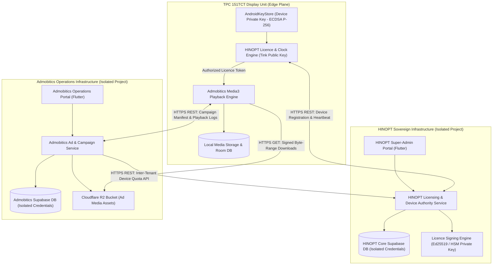
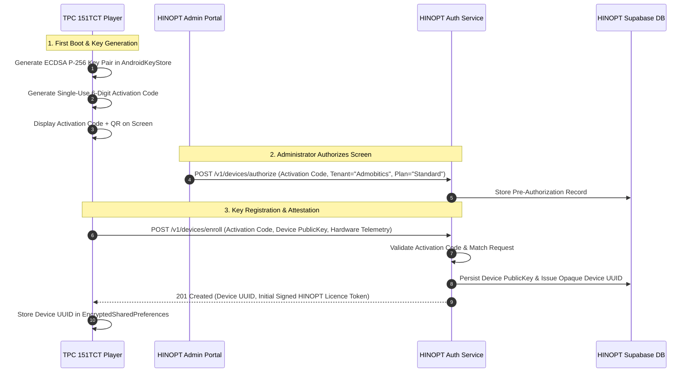
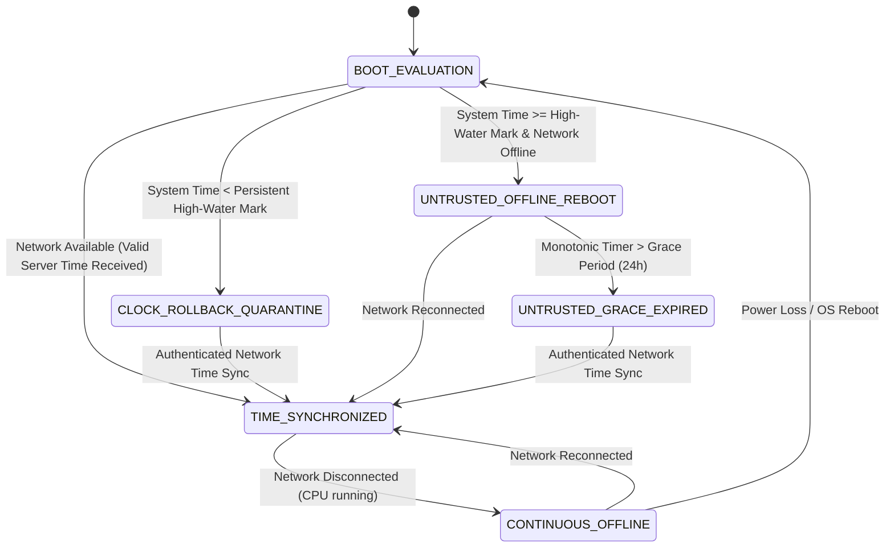
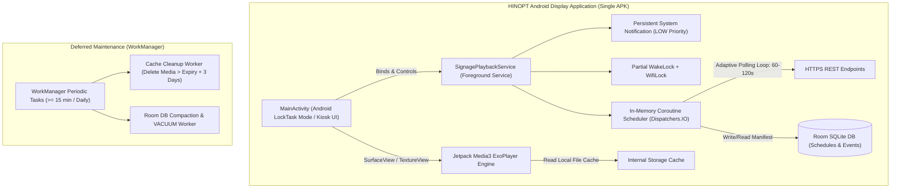
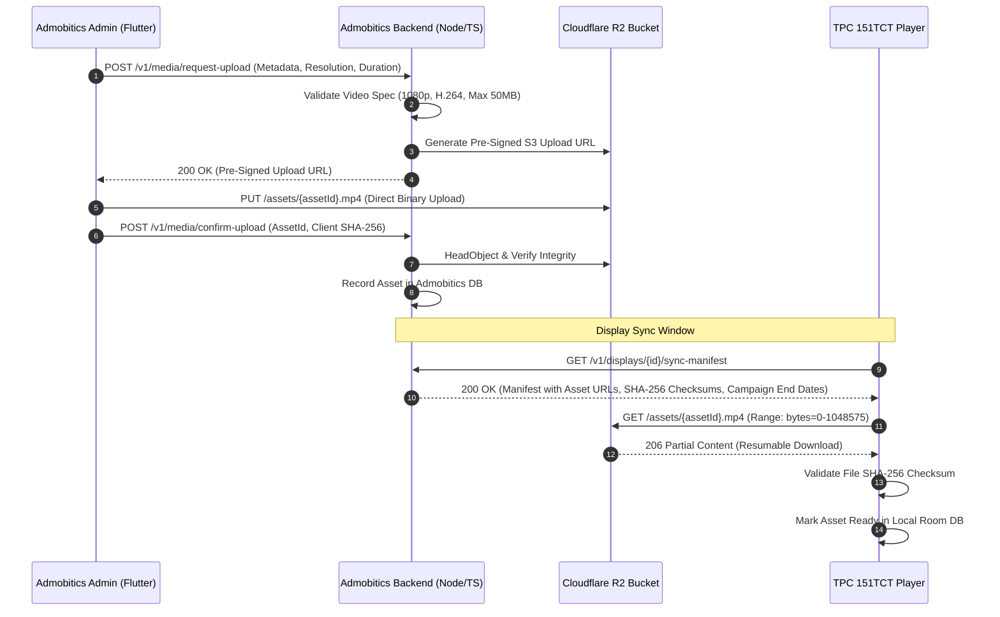
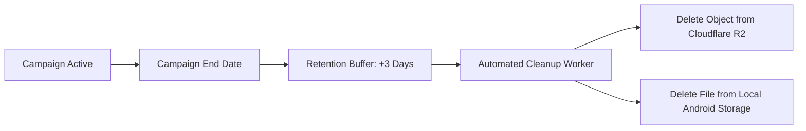

# Architectural Foundation & Engineering Framework (Revision 3.0)
## Project: HINOPT Advertising Software
**Platform Owner:** HINOPT  
**Commercial Tenant / Customer:** Admobitics  
**Role:** Principal Software Architect & Security Reviewer  
**Status:** Foundation Phase — Architectural Audit & Revision 3.0  
**Date:** November 2026

---

## 1. Executive Summary & Audit Log

Revision 3.0 resolves critical technical contradictions, security weaknesses, and hardware assumptions identified during the engineering review of Revision 2.0.

### 1.1 Summary of Architectural Corrections (Rev 2.0 vs Rev 3.0)

| Area | Revision 2.0 Flaw | Revision 3.0 Architectural Correction |
| :--- | :--- | :--- |
| **Offline Time Security** | Claimed `elapsedRealtime()` prevented tampering, ignoring that it resets to 0 on reboot. | Implemented a **formal 4-state time machine**. Defined a deterministic **Offline Reboot Policy** with high-water marks and an unanchored **Quarantine Safe State**. Explicitly documented physical limits. |
| **Database & Isolation** | Proposed 2 schemas (`hinopt`, `admobitics`) in 1 Supabase project. Bypassed by leaked `service_role`. | Enforced **two completely isolated Supabase projects / databases**. Master licensing credentials are physically and logically segregated from Admobitics ad operations. |
| **Android Background Engine**| Proposed WorkManager for 120-second polling (WorkManager has a hard 15-minute minimum). | Redesigned as a **Kiosk Foreground Architecture**: Android `Activity` in LockTask mode backed by a persistent **Foreground Service** running a coroutine polling loop. WorkManager reserved for deferred maintenance only. |
| **Device Identity & Keystore**| Vague hardware fingerprinting; mistakenly put HINOPT public key in Keystore. | Device generates **ECDSA P-256 key pair inside `AndroidKeyStore`** on enrollment. Keystore protects device private key. Public key registered with HINOPT. Requests authenticated via cryptographic signatures. |
| **Cryptography Compatibility**| Assumed native Ed25519 support on Android 10 Keystore (only supported in Android 12+). | Display identity uses **Android Keystore ECDSA P-256**. For HINOPT licence verification, public key signature verification uses **Google Tink** in user-space. Private signing keys remain strictly on HINOPT backend. |
| **Hardware Assumptions** | Assumed 5GB cache, H.264/H.265 hardware decoding, and 256MB memory as facts. | Reclassified all hardware targets as **Proposed Hypotheses**. Defined a comprehensive **Physical Hardware Benchmarking Suite** for the TPC 151TCT. |
| **Media Retention & Storage**| Undefined R2 lifecycle; no retention rules. | Formally defined **Cloudflare R2 storage architecture** with **Campaign End Date + 3 Days** automated deletion policy. Zero USB media ingress. Resumable chunked downloads with SHA-256 validation. |
| **Database Encryption** | Contradicted itself (encrypted Room DB vs plain SQLite). | Unified on **Plain SQLite (Room) for public media schedules** + **Android Keystore / EncryptedSharedPreferences for tokens/credentials**. Eliminates CPU/battery bottlenecks on 2GB RAM. |
| **Licence Revocation** | Claimed immediate offline revocation. | Corrected: **Offline revocation is impossible in a disconnected distributed system.** Revocation is eventual upon next network synchronization; offline enforcement relies on local licence expiry. |

---

## 2. Platform Ownership & Complete Infrastructure Isolation

HINOPT is the platform owner and sovereign licensing authority. Admobitics is an advertising operations customer and platform tenant. Under no circumstances may Admobitics have access to master licensing, device authorization, or HINOPT private keys.



### 2.1 Security Partition Rules

1. **Dual Supabase Instances:** Two physically separate Supabase projects with distinct project URLs, database credentials, JWT secrets, and `service_role` keys.
   - `hinopt-core`: Stores device authorizations, enrolled device public keys, hardware serials, licensing plans, and audit logs.
   - `admobitics-ads`: Stores advertiser accounts, campaigns, day-parting rules, creative metadata, screen groupings, and proof-of-play reports.
2. **Device Reference by Opaque ID:** `admobitics-ads` references displays solely by an opaque `hinopt_device_id` UUID issued by HINOPT. Admobitics cannot generate or authorize display IDs.
3. **Zero Shared Secrets:** Admobitics developers, services, and compromised credentials have zero access to `hinopt-core` or HINOPT signing keys.

---

## 3. Cryptography & Device Identity Architecture

### 3.1 Device Identity (Enrollment & Hardware-Backed Keystore)

Modern Android (Android 10+) strictly restricts access to non-resettable hardware identifiers (`Build.getSerial()` requires privileged permissions, MAC addresses are randomized). Device identity is established cryptographically:



- **Algorithm:** **ECDSA with NIST P-256 curve (`SHA256withECDSA`)**. Fully supported by `AndroidKeyStore` on Android 10 (API 29), leveraging hardware TEE/SE when available.
- **Request Authentication:** Display signs an HTTP digest/challenge on every API request using its Keystore private key (`X-Device-Signature: <ecdsa_sig>`). Backend verifies against stored public key.
- **Re-Enrollment Policy:** If device storage is wiped, the Keystore key is destroyed. The device must be re-enrolled through the HINOPT Admin Portal. An admin "Replace Display" workflow binds the new public key to the existing display license slot and revokes the previous key.

### 3.2 Master Licensing Cryptography (Backend Signing vs Player Verification)

- **Backend Private Key:** HINOPT Master Private Key (Ed25519) is retained exclusively in secure cloud key storage (e.g., Cloud KMS or offline cold storage for the Root CA, with short-lived operational intermediate signing keys). **Private keys are NEVER packaged in mobile/display applications.**
- **Player Verification:** Android 10 does not support Ed25519 in `AndroidKeyStore`. The Android display player verifies Ed25519 signatures in user-space using **Google Tink** (`com.google.crypto.tink:tink-android`).
- **Public Key Integrity:** HINOPT Public Verification Key is compiled into the app bytecode with root certificate pinning.

---

## 4. Offline Time Security & State Machine

### 4.1 Physical Reality & Threat Model

1. **Android 10 Clock Vulnerability:** Root or settings access can modify `System.currentTimeMillis()`.
2. **Reboot Vulnerability:** `SystemClock.elapsedRealtime()` resets to 0 whenever power is lost or the device reboots.
3. **RTC Uncertainty:** Without physical verification of a battery-backed hardware RTC on the TPC 151TCT, an offline reboot leaves the OS clock unverified.
4. **Guaranteed vs Unguaranteed Security:**
   - **Guaranteed:** Tamper-evident detection of clock rollbacks (`System.currentTimeMillis() < HighWaterMark`).
   - **Guaranteed:** Tamper-proof playback pacing *while continuously running* via `elapsedRealtime()`.
   - **Physical Limitation:** **Tamper-proof offline expiry across an unpowered reboot without network is physically impossible without a verified hardware-backed secure RTC.**

### 4.2 The 4-State Time Machine



### 4.3 Deterministic Behavior per State

1. **State 1: `TIME_SYNCHRONIZED` (Connected)**
   - Display receives authenticated HTTP `Date` header / server timestamp in every HTTPS response.
   - Local Anchor: `AnchorTime = ServerTime`, `AnchorElapsed = SystemClock.elapsedRealtime()`.
   - High-water mark in Room DB updated to `ServerTime`.
   - Full playback of all valid HINOPT licences and Admobitics campaigns.

2. **State 2: `CONTINUOUS_OFFLINE` (Offline, No Reboot)**
   - Current True Time calculated mathematically:  
     $$\text{CurrentTime} = \text{AnchorTime} + (\text{SystemClock.elapsedRealtime()} - \text{AnchorElapsed})$$
   - Wall-clock changes by user/OS are completely ignored.
   - Campaign expiry and HINOPT licence expiry are evaluated accurately.
   - High-water mark continuously advances in Room DB.

3. **State 3: `UNTRUSTED_OFFLINE_REBOOT` (Offline Reboot, Ambiguous Clock)**
   - Device boots offline. `elapsedRealtime()` is 0.
   - If `System.currentTimeMillis() < HighWaterMark`: **Immediate transition to `CLOCK_ROLLBACK_QUARANTINE`.**
   - If `System.currentTimeMillis() >= HighWaterMark`: Time is ambiguous.
   - **Operational Policy:** Device enters **Untrusted Grace Period** (configurable, default: 24 hours).
     - Plays only campaigns that were valid at `HighWaterMark` and whose `end_datetime > HighWaterMark + 24h`.
     - Monotonic timer enforces the 24-hour ceiling.
     - If network is not restored before 24 hours: transition to `UNTRUSTED_GRACE_EXPIRED`.

4. **State 4: `CLOCK_ROLLBACK_QUARANTINE` & `UNTRUSTED_GRACE_EXPIRED` (Safe States)**
   - **Zero commercial ads are played.**
   - Display enters HINOPT Safe Screen: renders fallback graphic, screen ID, offline timestamp, and diagnostic QR code for venue operators.
   - All playback audit logging records `SECURITY_TIME_SUSPENDED`.
   - Recovery occurs exclusively upon an authenticated HTTPS sync.

### 4.4 Independence of Licence vs Campaign Expiry

- **HINOPT Licence Expiry:** Checks HINOPT signed token validity. If invalid or expired, the player application locks into a suspended state. Admobitics engine cannot render anything.
- **Admobitics Campaign Expiry:** Checks campaign `end_datetime`. If expired, campaign is excluded from the playlist. If all campaigns expire, a default Admobitics house loop or black screen renders. HINOPT application remains operational.
- **Offline Revocation Limitation:** A licence revoked on the HINOPT server cannot be communicated to an offline player. Revocation takes effect on the **next successful HTTPS synchronization**. Until then, the player is governed strictly by the cryptographic `valid_until` timestamp in its local licence token.

---

## 5. Android Runtime & Kiosk Execution Architecture

### 5.1 Dispelling the WorkManager 120-Second Polling Flaw

- **The Rule:** Android `WorkManager.PeriodicWorkRequest` enforces a hard minimum interval of **15 minutes** (`PeriodicWorkRequest.MIN_PERIODIC_INTERVAL_MILLIS = 900,000ms`).
- **The Correction:** A commercial digital signage player on continuous AC power is **not a background mobile app**. It is a dedicated kiosk appliance.

### 5.2 Foreground Kiosk Process Architecture



### 5.3 Android 10 Execution Specifications

1. **LockTask Mode (Kiosk Mode):** The application is provisioned as Android Device Owner (`dpm set-device-owner`). Calls `startLockTask()` to suppress Home, Back, Recent Apps, and System Status Bar pull-down.
2. **Foreground Service:** `SignagePlaybackService` runs with `startForeground()`. Prevents the Android 10 Low Memory Killer (OOM) from terminating the process.
3. **Continuous Polling Loop:** Handled via a structured Kotlin Coroutine (`while(isActive) { delay(pollingInterval); executeSync(); }`) running inside the Foreground Service.
4. **WorkManager Role:** Strictly reserved for non-urgent deferred maintenance:
   - Daily media cache cleanup (purging expired ads).
   - Database compaction and log pruning.

---

## 6. Media Ingestion, Delivery & Cloudflare R2 Lifecycle

### 6.1 Media Pipeline Rules

- **Zero USB Media Ingress:** Display application contains zero USB listener, auto-mount handler, or file picker. The USB ports on the TPC 151TCT are physically disabled or locked via Android Device Policy Manager (`DISALLOW_MOUNT_PHYSICAL_MEDIA`).
- **Authorized Ingress Only:** Media assets can enter the system **only** through the Admobitics Admin Portal (Flutter), uploaded by authenticated operators.



### 6.2 Retention & Automated Deletion Policy



1. **The 3-Day Buffer Rule:** Media assets are retained in Cloudflare R2 and on local display storage for the duration of the scheduled campaign **plus exactly 3 additional days**.
   - *Rationale:* The 3-day buffer provides an audit and dispute window for advertisers to verify playback logs or request rerun proof before permanent deletion.
2. **Cloudflare R2 Lifecycle:** An automated backend cron job queries the Admobitics database daily for campaigns where `end_datetime < NOW() - INTERVAL '3 days'`. Associated media assets not linked to other active campaigns are permanently deleted from R2.
3. **Local Android Storage Purge:** A daily WorkManager maintenance task queries local Room DB for assets where `campaign_end_datetime < NOW() - 3 days` and unlinks the local file from disk.

---

## 7. Storage & Database Architecture Consistency

### 7.1 Resolving the Room Encryption Contradiction

Revision 2.0 contained a direct contradiction (diagram showed encrypted Room DB, while text recommended plain SQLite).

**Resolved Architectural Decision:**
- **Local Room Database:** **Plain SQLite (Unencrypted)**.
  - *Technical Justification:* Advertising campaign schedules, playlist orders, and video filenames are public commercial media, not sensitive personal data. Encrypting the entire Room database with SQLCipher introduces measurable CPU overhead, increases garbage collection pressure, and degrades I/O throughput on a low-power ARMv8 SoC with 2GB RAM.
- **Sensitive Credentials & Secrets:** **Encrypted via Android Keystore**.
  - Device private keys reside in hardware `AndroidKeyStore`.
  - Device UUID, auth tokens, and cryptographic high-water marks reside in `EncryptedSharedPreferences` (backed by Keystore MasterKey).
  - This provides zero-overhead video scheduling alongside enterprise-grade credential security.

### 7.2 Database ETag Efficiency Clarification

- Revision 2.0 stated that HTTP ETags reduce database queries.
- **Correction:** An HTTP `ETag` on its own saves **network bandwidth** (returns `304 Not Modified`), but still requires a backend query to compute or verify the version hash.
- **Architecture Solution:** The backend maintains an incrementing `manifest_version` or `updated_at` column in the `displays` table. The backend checks `If-None-Match` against this single indexed timestamp, avoiding full joins across campaigns, playlists, and creatives when no changes have occurred.

---

## 8. Physical Hardware Benchmarking Suite (TPC 151TCT)

Before code implementation, the following physical tests must be executed on the actual TPC 151TCT hardware to replace assumptions with verified empirical data:

```
tests/hardware/
├── test_01_storage_partition_audit.sh
├── test_02_codec_hardware_enumeration.kt
├── test_03_72h_video_playback_stress.kt
├── test_04_thermal_throttling_monitor.sh
├── test_05_ac_power_cycle_recovery.md
├── test_06_device_owner_kiosk_provisioning.sh
└── test_07_rtc_battery_persistence_audit.md
```

| Test ID | Objective | Procedure & Success Criteria |
| :---: | :--- | :--- |
| **HW-TEST-01** | **Storage Partition Measurement** | Run `df -h` and `StatFs` on `/data`. Measure exact usable MB on clean vendor OS. Success: $\ge 6.0\text{ GB}$ available for app cache. |
| **HW-TEST-02** | **Hardware Video Codec Audit** | Enumerate `MediaCodecList`. Verify presence of hardware H.264 (AVC) and H.265 (HEVC) decoders (`c2.*` or `OMX.*`, non-google). Success: Hardware 1080p @ 60fps profile supported. |
| **HW-TEST-03** | **72-Hour Memory & Playback Stress** | Run continuous seamless loop of 10x 1080p videos via Media3 for 72 hours. Profile heap via Android Studio Profiler. Success: Java heap stable $\le 192\text{MB}$, zero native memory leaks. |
| **HW-TEST-04** | **Thermal Dissipation Test** | Monitor `/sys/class/thermal/` during continuous playback in 40°C ambient chamber. Success: CPU temperature $\le 75^\circ\text{C}$; zero thermal throttling or dropped frames. |
| **HW-TEST-05** | **AC Power Loss & Reboot Test** | Cut mains AC power during playback. Restore power. Success: Device boots automatically without power button press; app auto-launches into LockTask mode within 45 seconds. |
| **HW-TEST-06** | **Device Owner Provisioning** | Execute `adb shell dpm set-device-owner com.hinopt.player/.AdminReceiver`. Success: LockTask mode activates; Home/Back/Status bar completely locked out. |
| **HW-TEST-07** | **RTC Battery Verification** | Disconnect network. Set system date. Cut power for 1 hour. Reapply power offline. Check `System.currentTimeMillis()`. Success: Clock maintains accurate time $\pm 5\text{s}$ while unpowered. |

---

## 9. Architecture Decision Records (ADRs) — Revised Statuses

In accordance with strict engineering governance, **no decision dependent on unverified physical hardware is marked "Accepted"**.

| ADR ID | Title | Status | Scope & Justification |
| :--- | :--- | :---: | :--- |
| **ADR-001** | Native Kotlin + Jetpack Media3 for Display Runtime | **Accepted** | Core architectural decision for Android 10 edge performance. |
| **ADR-002** | HTTPS REST Polling via Foreground Service (No WebSockets/MQTT) | **Accepted** | Eliminates connection broker overhead; compatible with 151TCT. |
| **ADR-003** | 4-State Offline Time Machine & Rollback Quarantine | **Accepted** | Formally replaces naive `elapsedRealtime()` design. |
| **ADR-004** | Dual Supabase Project Segregation (HINOPT vs Admobitics) | **Accepted** | Mandates complete physical and credential isolation. |
| **ADR-005** | Device Identity via AndroidKeyStore ECDSA P-256 | **Accepted** | Aligned with Android 10 hardware capabilities. |
| **ADR-006** | Cloudflare R2 Media Storage with 3-Day Retention Policy | **Accepted** | Zero egress fees; deterministic automated deletion. |
| **ADR-007** | Direct-Booked Deterministic Ad Engine (No Programmatic) | **Accepted** | Scoped strictly to direct-booked campaigns for Phase 1. |
| **ADR-008** | Storage Allocation: 5GB Media Cache & Dynamic Watermark | **Under Review** | **Pending HW-TEST-01 physical partition measurement.** |
| **ADR-009** | Hardware Watchdog Integration via TPC 151TCT MCU/GPIO | **Proposed** | **Pending vendor confirmation of hardware watchdog access.** |

---

## 10. Comprehensive Security Threat Model (STRIDE)

| Threat Category | Attack Vector / Scenario | Architectural Mitigation in Revision 3.0 |
| :--- | :--- | :--- |
| **Spoofing** | Rogue player attempts to register or impersonate a legitimate display. | Display generates ECDSA P-256 key in `AndroidKeyStore`. Every API request signed with private key. HINOPT backend verifies against registered public key. |
| **Tampering** | Operator modifies system clock offline to extend expired campaign or licence. | Monotonic elapsed ticker during continuous run; persistent Room high-water mark; 24-hour untrusted grace ceiling; immediate quarantine on rollback. |
| **Tampering** | Rogue media injection via USB flash drive. | USB storage access permanently blocked via Android Device Policy Manager (`DISALLOW_MOUNT_PHYSICAL_MEDIA`). Zero local file ingestion code. |
| **Repudiation** | Advertiser disputes whether an ad was actually displayed. | Playback reports record monotonic duration, frame render counts from Media3, start/end timestamps, and SHA-256 asset hash. |
| **Information Disclosure** | Admobitics user or compromised credential accesses HINOPT master licences. | Physical database isolation: separate Supabase projects with distinct credentials and network firewalls. |
| **Denial of Service** | Corrupted video file crashes display player in infinite reboot loop. | Media3 decodes in isolated playback loop. Crash counter traps repeated failures, quarantine-disables the faulty asset, and advances to next item. |
| **Elevation of Privilege** | Venue visitor touches screen to exit kiosk and access Android OS settings. | Android LockTask Mode (Kiosk) enabled via Device Owner. Navigation bar, status bar, power menu, and USB debugging disabled. |

---

## 11. Proposed Project Documentation Structure

The documentation structure reflects the strict dual-domain ownership and hardware verification requirements:

```
/
├── docs/
│   ├── adr/                                # Formal Architecture Decision Records
│   │   ├── ADR-001-native-kotlin-media3-runtime.md
│   │   ├── ADR-002-https-rest-foreground-polling.md
│   │   ├── ADR-003-four-state-offline-time-machine.md
│   │   ├── ADR-004-dual-supabase-project-isolation.md
│   │   ├── ADR-005-keystore-ecdsa-device-identity.md
│   │   ├── ADR-006-cloudflare-r2-media-lifecycle.md
│   │   ├── ADR-007-direct-booked-campaign-engine.md
│   │   ├── ADR-008-storage-cache-allocation.md
│   │   └── ADR-009-hardware-watchdog-integration.md
│   ├── specs/                              # Formal Specifications
│   │   ├── domain/                         # Domain Models & Glossaries
│   │   │   ├── HINOPT-DOM-001-master-licensing.md
│   │   │   └── ADMOB-DOM-001-advertising-campaigns.md
│   │   ├── protocols/                      # Interface Contracts & Schemas
│   │   │   ├── openapi-hinopt-auth-v1.yaml
│   │   │   ├── openapi-admobitics-campaigns-v1.yaml
│   │   │   ├── sync-manifest-schema-v1.json
│   │   │   └── playback-report-schema-v1.json
│   │   └── hardware/                       # TPC 151TCT Benchmarks & Kiosk Profile
│   │       ├── tpc-151tct-hardware-profile.md
│   │       └── physical-verification-suite.md
│   └── operational/                        # Runbooks & Threat Models
│       ├── stride-threat-model.md
│       ├── key-rotation-and-incident-recovery.md
│       └── kiosk-provisioning-runbook.md
```

---

## 12. Specification-Driven Development (SDD) Next Steps

With Revision 3.0 completed:
- **No application code has been written.**
- **No unverified hardware capabilities have been accepted.**
- **All technical contradictions have been resolved.**

We await your formal review and approval of Revision 3.0 before moving to **Stage 2: Complete Product Requirements (PRD)**.
