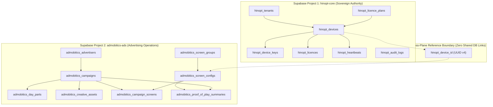
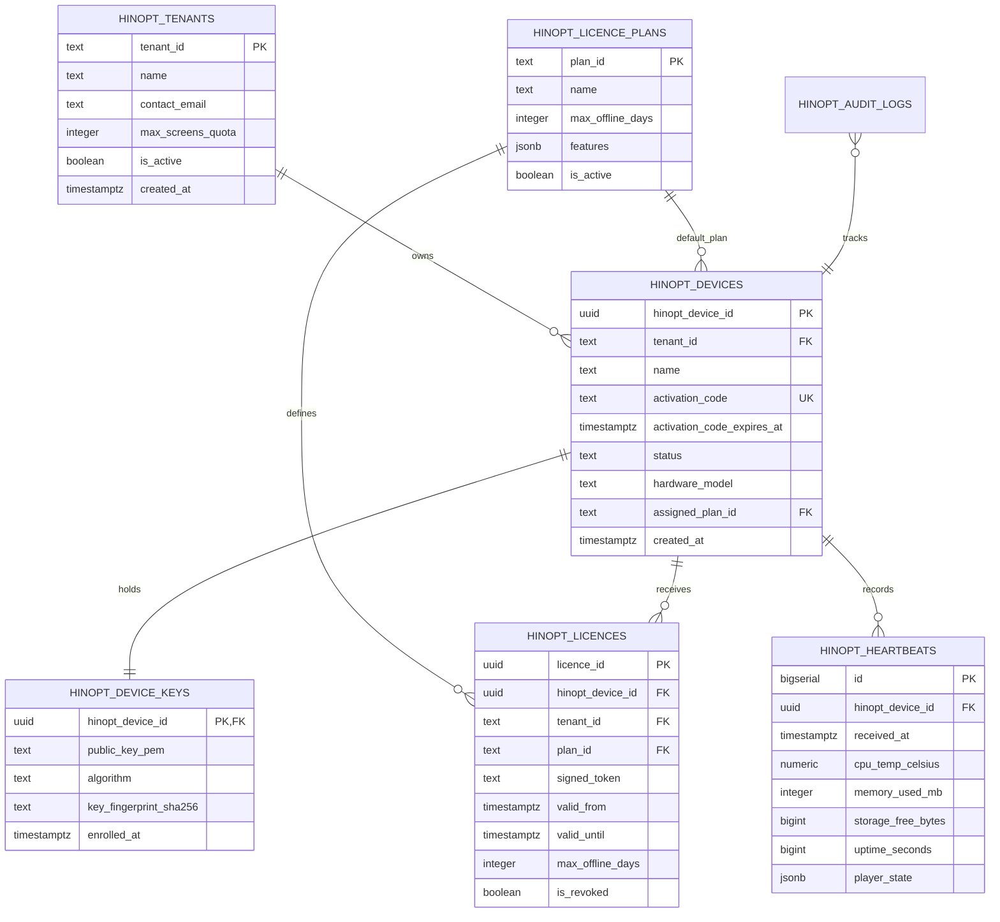
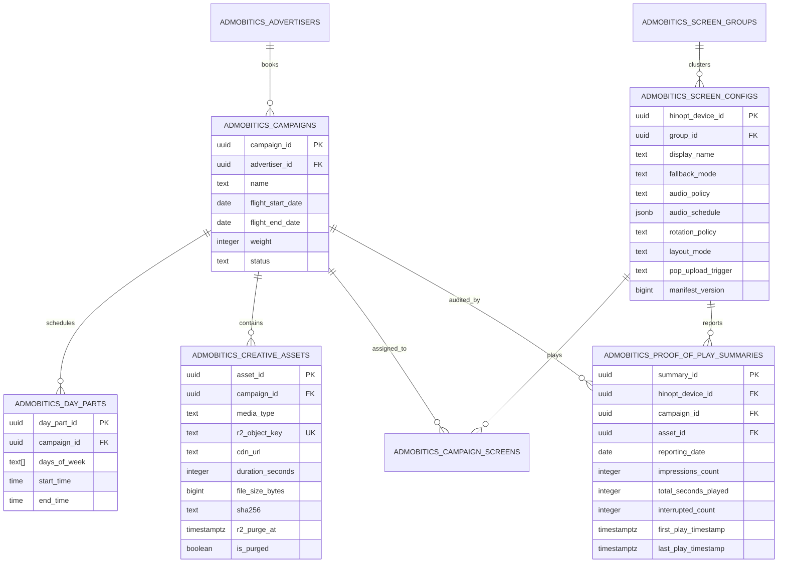

# Database Architecture & Supabase Isolation Specification

**Document Class:** Technical Engineering Standard  
**Project:** HINOPT Advertising Software  
**Version:** 1.0.0 (Phase 1 Baseline)  
**Authors:** Principal Software Architect (HINOPT)  

---

## 1. Executive Summary & Physical Project Segregation

In accordance with our ratified architectural decisions (ADR-004), HINOPT Advertising Software enforces **physical database isolation** across two separate Supabase cloud projects. Single-database schema splitting was explicitly rejected because a leaked or compromised `service_role` key would breach the sovereign master licensing system.



---

## 2. Security Invariants & Credentials Management

| Dimension | `hinopt-core` (Project 1) | `admobitics-ads` (Project 2) |
| :--- | :--- | :--- |
| **Domain Authority** | HINOPT Platform Owner | Admobitics Operations Tenant |
| **API Keys / Service Role** | Dedicated HINOPT secret keys; stored in HINOPT Cloud KMS | Dedicated Admobitics keys; managed by Admobitics devops |
| **Cross-Database Queries** | **Prohibited.** No foreign data wrappers (FDW) or direct SQL links. | **Prohibited.** |
| **Inter-Service Comms** | Secure HTTPS REST APIs with HMAC / mTLS authentication | Secure HTTPS REST APIs |
| **Entity Reference** | Issues master `hinopt_device_id` UUID | References `hinopt_device_id` as an opaque external key |
| **Signing Key Access** | Manages Ed25519 root/intermediate signing keys | **Zero access** to private signing keys |

---

## 3. `hinopt-core` Entity-Relationship Diagram



---

## 4. `admobitics-ads` Entity-Relationship Diagram



---

## 5. Performance Optimizations & Manifest Versioning

### 5.1 O(1) Manifest Change Detection
Instead of executing expensive relational `JOIN` queries across campaigns, day-parts, and creative assets on every 60-second display poll, the system maintains an incrementing `manifest_version` column on `admobitics_screen_configs`:
1. Whenever a campaign is assigned, updated, or removed, a PostgreSQL database trigger (`trg_campaign_screens_manifest_update`) automatically increments `manifest_version`.
2. When the display calls `GET /v1/displays/{id}/sync-manifest` with `If-None-Match: "v{manifest_version}"`:
   ```sql
   SELECT manifest_version FROM admobitics_screen_configs WHERE hinopt_device_id = $1;
   ```
3. If the version matches the client's `ETag`, the server immediately responds with **`304 Not Modified`** in sub-5ms with zero data transfer.

---

## 6. Retention & Automated Cleanup Workers

1. **R2 Asset Retention:** A daily background job queries `admobitics_creative_assets`:
   ```sql
   SELECT r2_object_key FROM admobitics_creative_assets
   WHERE r2_purge_at <= NOW() AND is_purged = FALSE;
   ```
   The backend deletes the objects from Cloudflare R2 and marks `is_purged = TRUE`.
2. **Heartbeat Data Pruning:** Telemetry records in `hinopt_heartbeats` older than 90 days are automatically pruned or archived to cold storage to keep database size predictable.
