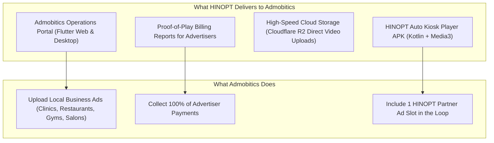

# Strategic Partnership Pitch Proposal
## Powering Admobitics Auto-Rickshaw Advertising with HINOPT Technology

**Prepared by:** HINOPT Technologies  
**Prepared for:** Admobitics Leadership Team  
**Proposal Date:** November 2026  
**Location:** Hyderabad, Telangana  
**Class:** Confidential — Strategic Business Proposal  

---

## 1. Executive Summary

**Admobitics** is pioneering digital-out-of-home (DOOH) auto-rickshaw advertising across the high-density transit corridors of Hyderabad (HITEC City, Madhapur, Gachibowli, Jubilee Hills, and Secunderabad).

**HINOPT Technologies** has developed a next-generation, industrial-grade **Ads Display Software Platform** engineered specifically for edge display screens in transit and retail environments.

### The Win-Win Partnership
To accelerate Admobitics' growth while establishing HINOPT's brand visibility across Hyderabad, **HINOPT proposes a 2-Year Zero-Cost Technology Partnership**:
- **HINOPT provides Admobitics with its complete, enterprise digital signage software platform for 100% FREE (₹0 software license fees) for 2 full years.**
- In exchange, **Admobitics allocates 1 permanent, complimentary 15-second advertising slot in every loop across its auto-rickshaw screens to promote HINOPT products and services.**
- **From Year 3 onwards**, Admobitics transitions to a family-subsidized maintenance rate of just **₹100 per screen / month**, while HINOPT retains its complimentary ad slot as a long-term strategic marketing partner.

---

## 2. The Auto-Rickshaw Challenge (And How HINOPT Solves It)

Running screens inside moving auto-rickshaws in Hyderabad presents unique technical challenges that crash standard consumer apps:

| The Auto-Rickshaw Problem | Why Other Softwares Fail | How HINOPT Solves It |
| :--- | :--- | :--- |
| **Frequent Battery Cutoffs** | Auto drivers turn off the engine at signals. Screens lose power abruptly, corrupting files and showing Android desktop upon restart. | **Automatic Kiosk Auto-Boot:** When the engine starts and power is restored, HINOPT launches automatically in Kiosk mode within 10 seconds and resumes video playback with zero manual touch needed. |
| **Cellular Dead Zones** | Autos drive under flyovers, underpasses, and weak 4G/5G areas. Cloud streaming apps freeze or show black buffering screens. | **100% Offline-First Engine:** Videos and schedules are cached locally on the screen. The display continues playing 24/7 without needing an active internet connection. |
| **Passenger / Driver Tampering** | Passengers or drivers touch the screen, exit to YouTube, change Android settings, or adjust system clocks. | **Android LockTask Mode:** Navigation bar, status bar pull-down, home/back buttons, and settings are completely locked down. Touch events are restricted. |
| **High Software Costs** | Off-the-shelf software (Yodeck, ScreenCloud) charges ₹1,200 to ₹2,500 per screen every month in foreign currency. | **₹0 Cost for Admobitics:** Zero upfront license fees, saving Admobitics lakhs of rupees in software overhead. |

---

## 3. Financial Benefits for Admobitics

By partnering with HINOPT, Admobitics maximizes its profitability from Day 1:

```
+--------------------------------------------------------------------------+
|                     ADMOBITICS REVENUE PROJECTION                        |
+--------------------------------------------------------------------------+
|  Standard 2-Minute Screen Loop: 8 Slots (15 Seconds Each)                |
|  - Slot 1: HINOPT Partner Slot (Free in exchange for software)           |
|  - Slots 2 to 8: Available for Admobitics Paying Advertisers (7 Slots)   |
+--------------------------------------------------------------------------+
|  Monthly Ad Slot Price in Hyderabad Autos:  ₹2,000 - ₹3,500 / slot       |
|  Monthly Ad Revenue from 1 Auto Screen:      7 x ₹2,500 = ₹17,500 / month |
|  Software Cost to Admobitics:               ₹0                           |
+--------------------------------------------------------------------------+
|  MONTHLY REVENUE FOR 10 AUTOS:              ₹1,75,000 / month            |
|  ANNUAL REVENUE FOR 10 AUTOS:               ₹21,00,000 / year (₹21 Lakhs)|
|  SOFTWARE SAVINGS FOR ADMOBITICS:           ₹1,50,000+ / year            |
+--------------------------------------------------------------------------+
```

Admobitics keeps **100% of the money collected from all paying commercial advertisers**, while operating on an enterprise-grade platform at zero software development or licensing cost.

---

## 4. Proposed Terms of Partnership

### Phase 1: Years 1 & 2 (Launch & Rapid Scale)
1. **Software Platform:** HINOPT provides the Android Display Kiosk APK, Cloud Ingestion APIs, and the dedicated Admobitics Business Portal for **₹0 (Free)**.
2. **Screen Quota:** Covers the initial 10 auto screens and automatically scales to all new autos added during the 2-year period.
3. **Advertising Exchange:** Admobitics provides HINOPT with **1 permanent 15-second slot per loop** (approx. 12.5% to 15% Share of Voice) across all active auto screens.
4. **HINOPT Product Updates:** HINOPT can update its promotional video/image creatives anytime as new products or startup apps launch.

### Phase 2: Year 3 Onwards (Long-Term Growth)
1. **Subsidized License Fee:** Admobitics pays a nominal software maintenance fee of **₹100 per active screen / month** (e.g., ₹1,000/month for 10 screens; ₹10,000/month for 100 screens).
2. **Continued Ad Partnership:** HINOPT retains 1 complimentary ad slot on all screens.
3. **Technical Support:** HINOPT provides continuous software updates, security patches, and cloud maintenance.

---

## 5. What Admobitics Gets (Deliverables)



1. **Admobitics Business Portal:** A web/desktop dashboard where Admobitics managers upload ads, build weekly day-part schedules, set loop orders, and monitor screen health.
2. **Kiosk Player APK:** Lightweight, battery-optimized Android APK installable on the 10 auto screens in under 2 minutes.
3. **Automated Proof-of-Play Reports:** The screens record every completed ad play and compile daily summaries, allowing Admobitics to show verified proof to its corporate advertisers.
4. **Zero USB Hassle:** Admobitics managers update ads remotely from their laptop—no need to manually visit autos with USB pen drives.

---

## 6. Implementation & 7-Day Pilot Roadmap

We propose a rapid **7-day onboarding timeline** to get all 10 autos running smoothly:

```
+------------+--------------------------------------------------------------+
| Day        | Milestone                                                    |
+------------+--------------------------------------------------------------+
| Day 1 - 2  | Sign simple 2-page partnership agreement.                    |
| Day 3      | Install HINOPT APK on 2 pilot autos for 48-hour road testing.|
| Day 4 - 5  | Verify auto-boot on ignition and offline continuous loop.    |
| Day 6      | Roll out APK across remaining 8 autos.                       |
| Day 7      | Launch live commercial advertiser campaigns + HINOPT ads!    |
+------------+--------------------------------------------------------------+
```

---

## 7. Conclusion & Next Step

This partnership offers **Admobitics free technology, zero operational headaches, and maximum profit margins**, while giving **HINOPT daily brand visibility across thousands of auto commuters in Hyderabad**.

We look forward to growing together as strategic partners.

**HINOPT Technologies**  
Hyderabad, Telangana  
*Website:* hinopt.com | *Email:* contact@hinopt.com
