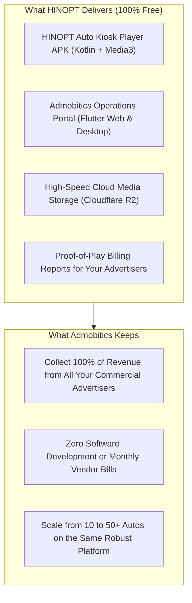

# Strategic Technology Partnership Proposal
## Powering Admobitics Auto-Rickshaw Advertising with HINOPT Technology

**Prepared by:** HINOPT Technologies  
**Prepared for:** Admobitics Leadership Team  
**Proposal Date:** November 2026  
**Location:** Hyderabad, Telangana  
**Class:** Confidential — Strategic Partnership Agreement  

---

## 1. Executive Summary

**Admobitics** is building Hyderabad’s premier in-auto digital advertising network across major transit and commercial corridors (HITEC City, Madhapur, Gachibowli, Jubilee Hills, and Secunderabad).

To ensure Admobitics operates on a reliable, industrial-grade technology platform without burning capital on software development or monthly vendor fees, **HINOPT Technologies proposes a 2-Year Strategic Partnership**:

* **Complete Software Platform for 100% Free (2 Years):** HINOPT provides the Android Display Player Kiosk software, Cloud Infrastructure, and the Admobitics Management Portal at **zero license cost (₹0)**.
* **Mutual Growth Through Co-Branding:** As fellow startups growing together, Admobitics includes **1 companion slot in the loop for HINOPT branding** across its auto screens, allowing both companies to build brand awareness side-by-side.
* **Long-Term Support:** From Year 3 onwards, Admobitics contributes a nominal, subsidized maintenance fee of just **₹100 per screen / month** to assist with raw cloud server hosting, while keeping the co-marketing slot active.

---

## 2. The Auto-Rickshaw Tech Challenge (And How HINOPT Solves It)

Running digital screens inside moving auto-rickshaws in Hyderabad presents unique real-world challenges that crash standard consumer video players. HINOPT was built specifically to solve these problems:

| The Operational Challenge | The Risk to Admobitics | How HINOPT Solves It |
| :--- | :--- | :--- |
| **Engine Cutoffs & Battery Drops** | Auto drivers turn off the engine at traffic signals. Standard players crash, show Android error screens, or require manual restart. | **Automatic Kiosk Resume:** When the engine starts and power returns, HINOPT automatically launches in Kiosk mode within 10 seconds and resumes video playback with zero manual touch. |
| **Cellular Dead Zones** | Autos travel under flyovers, underpasses, and weak network zones. Streaming tools freeze or show black loading spinners. | **100% Offline-First Playback:** All videos and schedules are stored securely on the screen's local memory. Ads play smoothly 24/7 with zero dependency on active internet. |
| **Screen Tampering** | Passengers or drivers touch the screen, exit to YouTube, or adjust device settings. | **Complete Kiosk Lock (LockTask):** System navigation bars, home/back buttons, and settings are completely locked down. Only approved ads can play. |
| **Remote Fleet Management** | Updating ads across 10 autos manually requires plugging in USB flash drives in each vehicle. | **One-Click Cloud Updates:** Admobitics managers upload ads remotely from their laptop; screens automatically sync whenever connected. |

---

## 3. What Admobitics Gets (Zero Cost, Full Ownership of Ad Revenue)



1. **Admobitics Operations Portal:** A clean, easy-to-use web dashboard where your team can upload video ads, assign schedules, and manage screens without needing any technical knowledge.
2. **Kiosk Player Software:** Built natively in Kotlin with hardware acceleration to prevent overheating and ensure 1080p smooth video playback on the TPC 151TCT panels.
3. **Verified Proof-of-Play Reports:** The player tallies completed plays locally, giving Admobitics professional reporting data to build trust with local Hyderabad businesses.
4. **100% Ad Revenue Kept by Admobitics:** Admobitics sells all its commercial ad slots and keeps **100% of all client revenue**.

---

## 4. Simple Terms of Partnership

### Phase 1: Years 1 & 2 (Launch & Growth Phase)
* **HINOPT Software License:** **₹0 (100% Free)** for all screens in the Admobitics auto fleet.
* **Screen Quota:** Covers the initial 10 auto screens and automatically scales to support new screens as Admobitics expands.
* **Co-Marketing Support:** Admobitics reserves **1 slot (15 seconds)** in the standard loop across screens to showcase HINOPT branding and future tech products.
* **Zero Overhead:** Admobitics pays nothing for the software, updates, or maintenance.

### Phase 2: Year 3 Onwards (Long-Term Maintenance)
* **Nominal Maintenance Contribution:** Admobitics contributes a small fee of **₹100 per active screen / month** to assist in covering raw cloud hosting and database costs.
* **Continued Co-Marketing:** HINOPT retains its single promotional slot across the fleet.
* **Ongoing Engineering Support:** HINOPT continues providing free feature updates, Android OS compatibility patches, and technical support.

---

## 5. 7-Day Pilot Onboarding Plan

```
+------------+--------------------------------------------------------------+
| Timeline   | Action Item                                                  |
+------------+--------------------------------------------------------------+
| Day 1 - 2  | Review and agree on strategic partnership terms.             |
| Day 3      | Install HINOPT APK on 2 pilot autos for a 48-hour road test. |
| Day 4 - 5  | Verify auto-boot on ignition and offline continuous loop.    |
| Day 6      | Install APK across the remaining 8 autos.                    |
| Day 7      | Launch live commercial advertiser campaigns smoothly!        |
+------------+--------------------------------------------------------------+
```

---

## 6. Conclusion

This partnership gives **Admobitics a rock-solid, production-grade technology platform built specifically for moving auto-rickshaws at zero cost**, allowing Admobitics to focus 100% on signing advertisers and generating revenue, while both companies build brand visibility across Hyderabad.

**HINOPT Technologies**  
Hyderabad, Telangana  
*Email:* contact@hinopt.com
