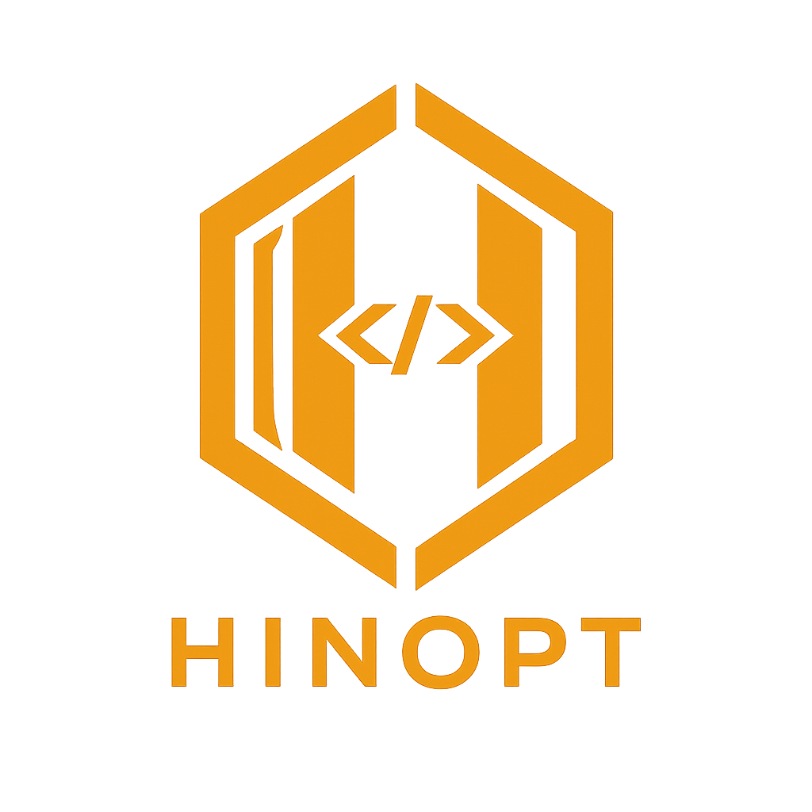

# Strategic Technology Partnership Proposal
## Powering Admobitics Auto-Rickshaw Advertising with HINOPT Technology

**Document Reference:** HINOPT-PROP-2026-ADM01  
**Prepared by:** HINOPT Technologies ([hinopt.com](https://hinopt.com))  
**Prepared for:** Admobitics Leadership Team ([admobitics.vercel.app](https://admobitics.vercel.app))  
**Proposal Date:** November 2026  
**Operational Hubs:** Hyderabad & Visakhapatnam, India  
**Classification:** Confidential — Strategic Partnership & Co-Growth Agreement  

---

## 1. Executive Summary

**Admobitics** is pioneering Hyderabad’s premier in-auto digital advertising network across major commercial, IT, and residential corridors (HITEC City, Madhapur, Gachibowli, Jubilee Hills, and Secunderabad).

To ensure Admobitics operates on a resilient, industrial-grade technology platform without burning capital on third-party software development or recurring software vendor subscriptions, **HINOPT Technologies proposes a 2-Year Strategic Partnership**:

* **Complete Software Platform for 100% Free (2 Years):** HINOPT delivers the Android Display Player Kiosk software, Cloud Infrastructure, and the Admobitics Management Portal at **zero license cost (₹0)**.
* **Mutual Growth Through Co-Branding:** As fellow startups building the future together, Admobitics provides **1 companion slot (15 seconds)** in the standard playback loop for HINOPT branding and future tech products, driving brand visibility for both companies.
* **Full Revenue Retention for Admobitics:** Admobitics keeps **100% of all commercial advertising revenue**. HINOPT takes zero commission, zero revenue cut, and zero setup fee.
* **Long-Term Sustainable Maintenance:** From Year 3 onwards, Admobitics contributes a nominal, subsidized maintenance fee of just **₹100 per screen / month** to assist with raw cloud server hosting, while keeping the companion slot active.

---

## 2. HINOPT Technology Credentials & Engineering Proof

**HINOPT Technologies** ([hinopt.com](https://hinopt.com)) is a specialized digital product engineering and enterprise technology firm headquartered in Visakhapatnam and Hyderabad, India.

### Verified Corporate & Technical Credentials:
* **Official Website:** [https://hinopt.com](https://hinopt.com)
* **Direct Contact:** `hello@hinopt.com` | `+91 9390952712`
* **Core Competency:** Enterprise offline-first applications, native Android hardware kiosks, multi-tenant cloud platforms, and automated workflow systems.
* **Existing Proof with Admobitics:** HINOPT designed, engineered, and deployed Admobitics' primary public digital platform ([admobitics.vercel.app](https://admobitics.vercel.app)), giving HINOPT direct institutional knowledge of Admobitics' brand identity, market positioning, and operational objectives.
* **Proven Production Track Record:**
  * *Dream Desserts:* Real-time QR ordering, billing, and store operations engine.
  * *Cafe Coffee Delite:* Contactless in-store dining & digital table ordering ecosystem.
  * *Hinopt Restaurant Platform:* Multi-branch order orchestration and kitchen display software.
  * *Hinopt Hostel System:* Resident operations and student companion management platform.

---

## 3. The Auto-Rickshaw Tech Challenge (And How HINOPT Solves It)

Running digital screens inside moving auto-rickshaws in Hyderabad presents severe hardware and environmental hurdles that crash standard consumer video players. HINOPT was engineered specifically to solve these operational pain points:

| The Operational Challenge | The Risk to Admobitics | How HINOPT Solves It |
| :--- | :--- | :--- |
| **Engine Cutoffs & Battery Drops** | Auto drivers turn off the engine at traffic signals. Standard players crash, show Android error screens, or require manual restart. | **Automatic Kiosk Resume:** When the engine starts and power returns, HINOPT automatically launches in Kiosk mode within 10 seconds and resumes video playback with zero manual touch. |
| **Cellular Dead Zones** | Autos travel under flyovers, underpasses, and weak network zones. Streaming tools freeze or show black loading spinners. | **100% Offline-First Playback:** All videos and schedules are stored securely on the screen's local memory. Ads play smoothly 24/7 with zero dependency on active internet. |
| **Screen Tampering** | Passengers or drivers touch the screen, exit to YouTube, or adjust device settings. | **Complete Kiosk Lock (LockTask):** System navigation bars, home/back buttons, and settings are completely locked down. Only approved ads can play. |
| **Remote Fleet Management** | Updating ads across 10 autos manually requires plugging in USB flash drives in each vehicle. | **One-Click Cloud Updates:** Admobitics managers upload ads remotely from their laptop; screens automatically sync whenever connected. |

---

## 4. What Admobitics Gets (Zero Cost, Full Ownership of Ad Revenue)

1. **Admobitics Operations Web Portal:** A clean, easy-to-use web dashboard where your team can upload video ads, assign schedules, and manage screens without needing any technical knowledge.
2. **Kiosk Player Software (Kotlin + Media3):** Built natively with hardware acceleration to prevent overheating and ensure 1080p smooth video playback on the TPC 151TCT panels.
3. **Verified Proof-of-Play (PoP) Reports:** The player tallies completed plays locally, giving Admobitics professional reporting data to build trust with local Hyderabad businesses.
4. **100% Ad Revenue Kept by Admobitics:** Admobitics sells all its commercial ad slots and keeps **100% of all client revenue**.
5. **Seamless Scalability:** Ready to scale from 10 auto screens to 50, 100, or 500+ across Hyderabad and Telangana without any platform re-architecture.

---

## 5. Simple Terms of Partnership

### Phase 1: Years 1 & 2 (Launch & Growth Phase)
* **HINOPT Software License:** **₹0 (100% Free)** for all screens in the Admobitics auto fleet.
* **Screen Quota:** Covers the initial 10 auto screens and automatically scales to support new screens as Admobitics expands.
* **Co-Marketing Support:** Admobitics reserves **1 companion slot (15 seconds)** in the standard loop across screens to showcase HINOPT branding and future tech products.
* **Zero Overhead:** Admobitics pays nothing for the software, updates, bug fixes, or maintenance.

### Phase 2: Year 3 Onwards (Long-Term Maintenance)
* **Nominal Maintenance Contribution:** Admobitics contributes a small fee of **₹100 per active screen / month** to assist in covering raw cloud hosting and database costs.
* **Continued Co-Marketing:** HINOPT retains its single promotional slot across the fleet.
* **Ongoing Engineering Support:** HINOPT continues providing free feature updates, Android OS compatibility patches, and technical support.

---

## 6. 7-Day Pilot Onboarding Plan

| Timeline | Action Item & Milestone |
| :--- | :--- |
| **Day 1 – 2** | Review and sign mutual partnership terms. |
| **Day 3** | Install HINOPT APK on 2 pilot autos for a 48-hour road test. |
| **Day 4 – 5** | Verify auto-boot on ignition, vibration resilience, and offline continuous loop. |
| **Day 6** | Install APK across the remaining 8 auto-rickshaws. |
| **Day 7** | Launch live commercial advertiser campaigns smoothly across all 10 screens! |

---

## 7. Partnership Agreement & Execution Sign-Off

By signing below, both parties acknowledge and accept this strategic partnership on the terms outlined above.

| HINOPT Technologies (Platform Partner) | Admobitics (Media & Fleet Partner) |
| :--- | :--- |
| **Authorized Signatory:** _______________________ | **Authorized Signatory:** _______________________ |
| **Name:** _____________________________________ | **Name:** _____________________________________ |
| **Designation:** Founder / Technical Director | **Designation:** Managing Partner / Director |
| **Date:** _____________________________________ | **Date:** _____________________________________ |
| **Contact:** hello@hinopt.com \| +91 9390952712 | **Contact:** contact@admobitics.com |
| **Website:** https://hinopt.com | **Website:** https://admobitics.vercel.app |
|   *(Company Seal / Stamp)* |   *(Company Seal / Stamp)* |

---

**HINOPT Technologies** — Hyderabad & Visakhapatnam, India  
*Official Web:* [https://hinopt.com](https://hinopt.com)
