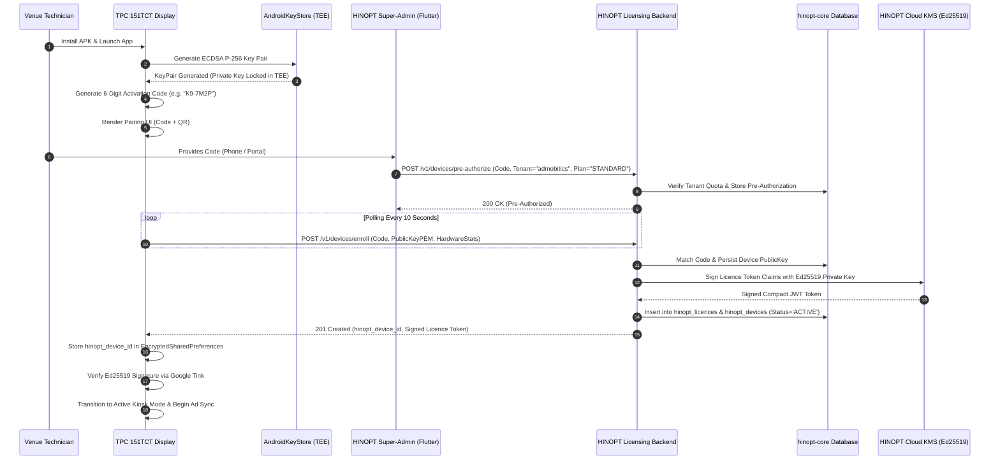
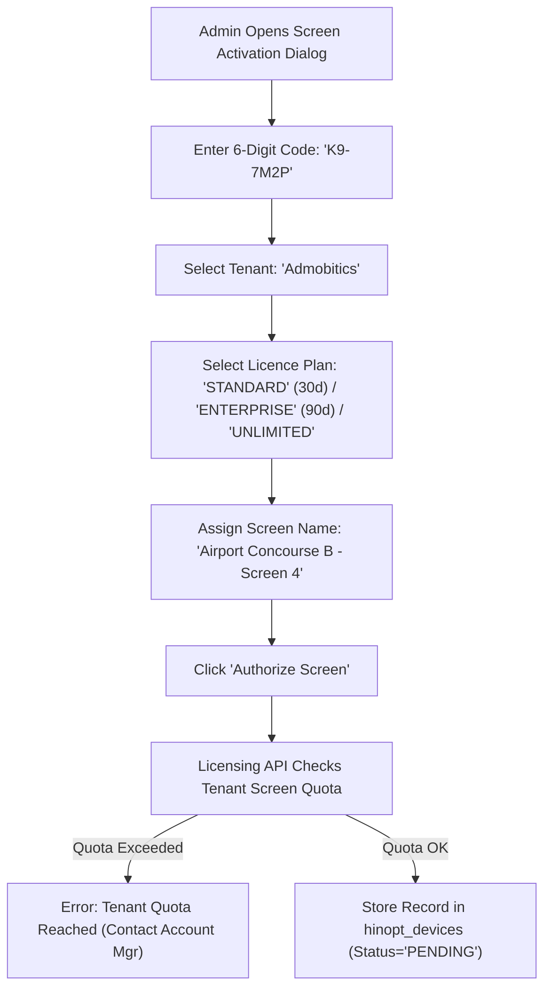
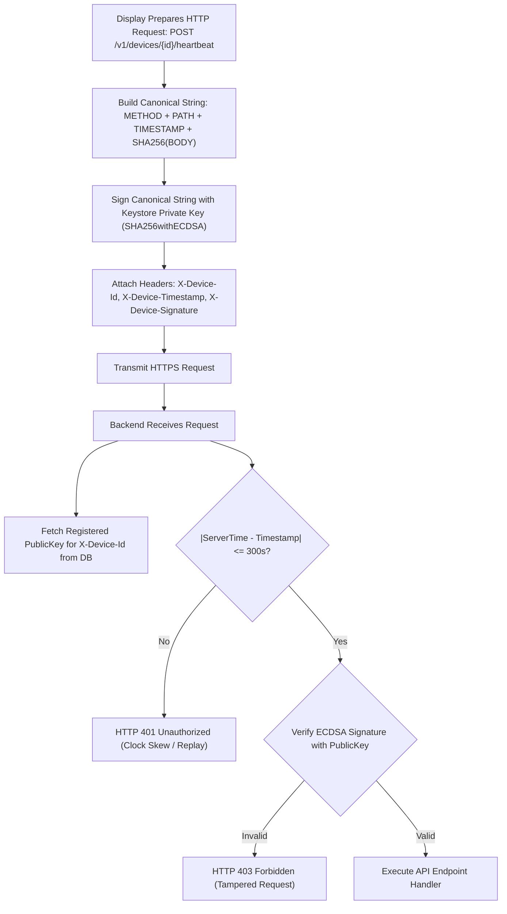

# FEAT-001: Device Enrollment & Sovereign Licensing Specification

**Feature ID:** HINOPT-FEAT-001  
**Project:** HINOPT Advertising Software  
**Version:** 1.0.0 (Phase 1 Baseline)  
**Status:** Ratified Feature Specification  
**Classification:** Core Security & Functional Specification  
**Authors:** Principal Software Architect (HINOPT)  
**Target Systems:** Android Display Player (`apps/android-player`), HINOPT Admin Portal (`apps/hinopt-admin`), Licensing Service (`backend/licensing-service`)  

---

## 1. Executive Summary & Workflow Overview

This specification details the end-to-end cryptographic and user workflow for **onboarding, authorizing, cryptographically pairing, licensing, and renewing** a **TPC 151TCT** display unit on the HINOPT network.

It enforces the fundamental security invariant: **no screen may render commercial advertisements without a cryptographically valid, unexpired HINOPT master licence token signed by HINOPT's private key.**



---

## 2. Display Player Lifecycle & Keystore Initialization

### 2.1 First Boot & Key Generation (`AndroidKeyStore`)

When the HINOPT display APK launches on a newly installed TPC 151TCT device, it executes `DeviceEnrollmentManager.initialize()`:

1. **Check Existing State:** Checks `EncryptedSharedPreferences` for an existing `hinopt_device_id`.
   - If present: Validates the cached licence token; transitions directly to normal playback.
   - If absent: Transitions to **`UNENROLLED`** state.
2. **Generate Asymmetric Identity:** Calls Android KeyStore:
   ```kotlin
   val keyPairGenerator = KeyPairGenerator.getInstance(
       KeyProperties.KEY_ALGORITHM_EC, 
       "AndroidKeyStore"
   )
   val parameterSpec = KeyGenParameterSpec.Builder(
       "hinopt_device_identity",
       KeyProperties.PURPOSE_SIGN or KeyProperties.PURPOSE_VERIFY
   )
   .setDigests(KeyProperties.DIGEST_SHA256)
   .setAlgorithmParameterSpec(ECGenParameterSpec("secp256r1")) // NIST P-256
   .build()

   keyPairGenerator.initialize(parameterSpec)
   val keyPair = keyPairGenerator.generateKeyPair()
   ```
3. **Hardware Root-of-Trust:** The private key remains locked inside hardware secure storage (TEE) and is marked non-exportable.
4. **Generate Activation Code:** Generates a 6-character string from alphabet `23456789ABCDEFGHJKLMNPQRSTUVWXYZ` using `SecureRandom`.
5. **Set Expiration Timer:** The activation code expires after **15 minutes** ($900\text{ seconds}$). If unclaimed, a coroutine regenerates a new code and updates the screen.

### 2.2 Pairing Screen Display UI

While in `UNENROLLED` state, `MainActivity` renders a full-screen, high-contrast pairing interface:
- **Display ID Prompt:** Clean branding: *"HINOPT Display Activation"*.
- **Large 6-Digit Code:** Displayed in monospace 72pt font: `K 9 - 7 M 2 P`.
- **Dynamic QR Code:** Encodes a deep-link payload for mobile technician scanning:
  `https://admin.hinopt.com/activate?code=K97M2P&model=TPC151TCT`
- **Device Diagnostic Bar:** Shows IP Address, MAC, Android OS (10 / API 29), App Version, and Countdown Timer (`Expires in 14:45`).

---

## 3. HINOPT Super-Admin Portal Authorization Workflow

A HINOPT super-administrator authorizes screens through the Flutter web/desktop application (`apps/hinopt-admin`):



### 3.1 Pre-Authorization API Contract

```http
POST /v1/devices/pre-authorize HTTP/1.1
Host: authority.hinopt.com
Authorization: Bearer <SuperAdmin_JWT>
Content-Type: application/json

{
  "activation_code": "K97M2P",
  "tenant_id": "admobitics",
  "name": "Delhi Metro - Rajiv Chowk Concourse 1",
  "plan_id": "STANDARD",
  "max_offline_days": 30
}
```

**Response (`200 OK`):**
```json
{
  "status": "PRE_AUTHORIZED",
  "activation_code": "K97M2P",
  "tenant_id": "admobitics",
  "expires_at": "2026-11-19T06:45:00Z"
}
```

---

## 4. Cryptographic Handshake & Licence Issuance

### 4.1 Device Enrollment Request

While displaying the pairing screen, the Android display player polls every **10 seconds**:

```http
POST /v1/devices/enroll HTTP/1.1
Host: authority.hinopt.com
Content-Type: application/json

{
  "activation_code": "K97M2P",
  "public_key_pem": "-----BEGIN PUBLIC KEY-----\nMFkwEwYHKoZIzj0CAQYIKoZIzj0DAQcDQgAE7p...\n-----END PUBLIC KEY-----",
  "hardware_model": "TPC 151TCT",
  "os_version": "Android 10 (API 29)",
  "app_version": "1.0.0-build.42",
  "nonce": "f8a7b6c5-d4e3-4f2a-1b0c-9d8e7f6a5b4c"
}
```

### 4.2 Backend Processing & Cryptographic Signing

1. **Code Validation:** Backend queries `hinopt_devices` for an active `activation_code = 'K97M2P'`. If expired or missing, returns `404 Not Found`.
2. **Quota Check:** Confirms `COUNT(active_screens) < max_screens_quota` for the tenant.
3. **Register Public Key:** Inserts the device's public key PEM into `hinopt_device_keys`.
4. **Issue Device UUID:** Assigns a permanent `hinopt_device_id` (e.g., `d4e5f6a7-b8c9-4d0e-1f2a-3b4c5d6e7f8a`).
5. **Construct Licence JWT:** Compiles the token payload with validity dates (`NOW()` to `NOW() + 30 days`).
6. **Sign via Cloud KMS:** Requests Cloud KMS to sign the JWT with the HINOPT Ed25519 private key.
7. **Transition Status:** Updates `hinopt_devices.status = 'ACTIVE'`, burns the activation code (`activation_code = NULL`).

### 4.3 Enrollment Success Response (`201 Created`)

```json
{
  "hinopt_device_id": "d4e5f6a7-b8c9-4d0e-1f2a-3b4c5d6e7f8a",
  "tenant_id": "admobitics",
  "assigned_name": "Delhi Metro - Rajiv Chowk Concourse 1",
  "licence": {
    "licence_id": "e1f2a3b4-c5d6-4e7f-8a9b-0c1d2e3f4a5b",
    "plan_id": "STANDARD",
    "valid_from": 1733011200,
    "valid_until": 1735689600,
    "max_offline_days": 30,
    "signed_token": "eyJhbGciOiJFZERTQSI...<Ed25519_JWT>...vGq1"
  },
  "endpoints": {
    "hinopt_heartbeat_url": "https://authority.hinopt.com/v1/devices/d4e5f6a7-b8c9-4d0e-1f2a-3b4c5d6e7f8a/heartbeat",
    "admobitics_sync_url": "https://api.admobitics.hinopt.com/v1/displays/d4e5f6a7-b8c9-4d0e-1f2a-3b4c5d6e7f8a/sync-manifest"
  }
}
```

---

## 5. Request Authentication Protocol (`X-Device-Signature`)

Following enrollment, the display player authenticates **every single API request** to both HINOPT and Admobitics services using HTTP message signatures.



---

## 6. Rolling Licence Renewal & Telemetry Heartbeat

To prevent displays from suddenly expiring while operating normally, HINOPT implements a **rolling background licence renewal**:

1. **Heartbeat Cadence:** Display sends a heartbeat every **5 minutes** when connected.
2. **Renewal Trigger Window:** If `CurrentTrueTime >= valid_until - 7 days` (within the final 7 days of the active licence):
   - The HINOPT backend automatically issues a fresh 30-day (or 90-day) Ed25519 signed licence token.
   - The new token is returned in the heartbeat response payload.
3. **Atomic Edge Replacement:** The display verifies the new token's signature and atomically updates its local Room database and `EncryptedSharedPreferences`.
4. **Seamless Continuity:** Playback continues with zero interruption or screen flashing.

---

## 7. Licence Expiry & Revocation Mechanics

### 7.1 Scenario 1: Online Administrative Revocation
1. HINOPT Super-Admin selects display in HINOPT Admin Portal and clicks **"Revoke Screen"**.
2. Admin enters mandatory revocation reason: *"Contract terminated by venue"*.
3. Backend sets `hinopt_devices.status = 'REVOKED'` and `hinopt_licences.is_revoked = TRUE`.
4. On the display's next heartbeat poll (within 5 minutes):
   - Backend responds with **`403 Forbidden`** (`code: "LICENCE_REVOKED"`).
5. Display deletes local licence token and locks screen into the **HINOPT Unlicensed Screen**.

### 7.2 Scenario 2: Offline Expiry
1. Display is operating completely offline.
2. The display's 4-State Time Security Engine advances True Time.
3. When `TrueTime >= licence.valid_until`:
   - Display player transitions `player_state = SUSPENDED`.
   - Media3 video playback halts immediately.
   - Screen renders the **HINOPT Licence Expired Screen** with contact QR code.
   - Zero commercial advertisements are rendered until connected and re-licensed.

---

## 8. Screen Replacement & Re-Enrollment Protocol

If a TPC 151TCT display experiences hardware failure or is replaced on-site:

1. **Technician Installs Replacement Unit:** New unit boots with fresh Keystore key and generates a new activation code (`M4-9X2L`).
2. **Admin "Replace Display" Flow:**
   - In HINOPT Admin Portal, admin selects the broken screen (`Airport Concourse B - Screen 4`).
   - Clicks **"Replace Hardware"**.
   - Enters new activation code: `M4-9X2L`.
3. **Seamless Transfer:**
   - HINOPT backend revokes the old public key and binds the new public key to the existing `hinopt_device_id`.
   - The new unit receives the existing `hinopt_device_id`, preserving all Admobitics campaign schedules, screen group memberships, and proof-of-play history.
   - The old unit's public key is permanently annulled.

---

## 9. Acceptance Criteria (Gherkin Verification Scenarios)

```gherkin
Feature: HINOPT Device Enrollment and Sovereign Licensing

  Scenario: Successful first-time device activation and licensing
    Given a freshly installed TPC 151TCT display with no existing identity
    When the HINOPT display application launches for the first time
    Then an ECDSA P-256 key pair is generated in AndroidKeyStore
    And a 6-character activation code is displayed on the screen with a 15-minute countdown
    When a HINOPT super-admin authorizes the code for tenant "admobitics" with plan "STANDARD"
    And the display polls the enrollment endpoint
    Then the backend returns HTTP 201 with an opaque hinopt_device_id and a signed Ed25519 licence
    And the display validates the licence signature locally using Google Tink
    And the display transitions from the pairing screen to the active signage engine

  Scenario: Reject expired activation code
    Given a display showing an activation code generated 16 minutes ago
    When an administrator attempts to authorize the activation code
    Then the backend rejects the request with HTTP 400 "ACTIVATION_CODE_EXPIRED"
    And the display automatically regenerates a fresh activation code

  Scenario: Tampered HTTP request signature rejection
    Given an enrolled display with a registered ECDSA P-256 public key
    When an attacker intercepts and modifies the request payload without re-signing
    Then the backend signature verification fails
    And the backend returns HTTP 403 "INVALID_DEVICE_SIGNATURE"

  Scenario: Automatic rolling background licence renewal
    Given an active display with a licence expiring in 4 days
    When the display transmits its scheduled 5-minute telemetry heartbeat
    Then the backend detects the licence is within the 7-day renewal window
    And the heartbeat response includes a newly signed 30-day licence token
    And the display verifies and installs the renewed licence without interrupting playback
```

---

*HINOPT Advertising Software Specification — End of FEAT-001*
