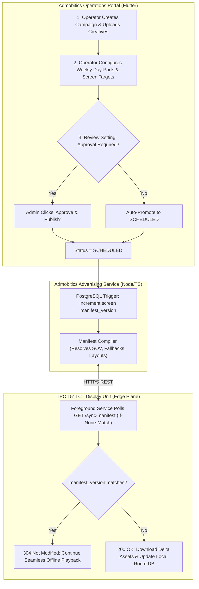
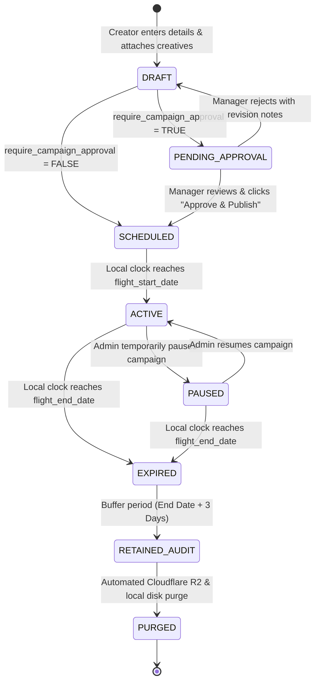
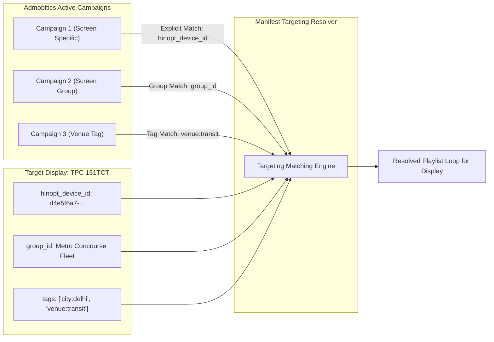
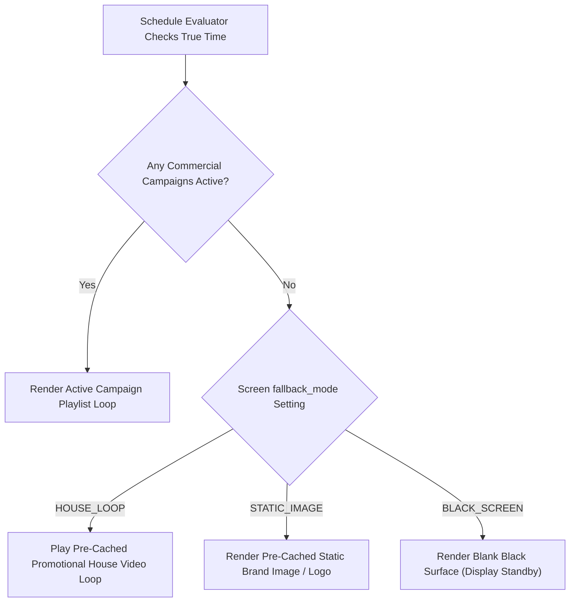

# FEAT-002: Campaign Scheduling & Sync Manifest Specification

**Feature ID:** HINOPT-FEAT-002  
**Project:** HINOPT Advertising Software  
**Version:** 1.0.0 (Phase 1 Baseline)  
**Status:** Ratified Feature Specification  
**Classification:** Core Functional Specification  
**Authors:** Principal Software Architect (HINOPT)  
**Target Systems:** Admobitics Business Portal (`apps/business-admin`), Advertising Service (`backend/advertising-service`), Android Display Player (`apps/android-player`)  

---

## 1. Executive Summary & System Overview

This specification details the end-to-end lifecycle of direct-booked advertising campaigns, weekly day-part scheduling matrices, screen targeting resolution, playlist rotation algorithms, and $O(1)$ sync manifest delivery within the **Admobitics Advertising Operations Domain**.

It defines how ad campaigns created in the **Admobitics Admin Portal (Flutter)** are compiled into deterministic, cacheable manifests and rendered autonomously on **TPC 151TCT** display screens.



---

## 2. Campaign Creation & Approval Workflow (Owner Configurable)

In accordance with our ratified product decisions, campaign publishing supports an **Owner's Choice in Settings** (`require_campaign_approval: boolean`):



### 2.1 Approval Policy Settings

- **Setting Location:** Configured in Admobitics Admin Portal $\rightarrow$ *Settings $\rightarrow$ Campaign Governance*.
- **When `require_campaign_approval = true`:** Campaigns created by account executives or clients remain in `PENDING_APPROVAL` status. An authorized Operations Manager must inspect the creative content, target screens, and flight dates before publishing.
- **When `require_campaign_approval = false`:** Campaigns transition directly from `DRAFT` to `SCHEDULED` upon saving, streamlining rapid deployments.

---

## 3. Creative Asset Rules & Duration Policies (Owner Configurable)

The platform supports both high-definition video and static image creatives:

| Asset Type | Technical Specs | Duration Policy (Admin Choice) |
| :--- | :--- | :--- |
| **Video Asset** | MP4 Container, H.264 (AVC Baseline/Main/High), AAC audio, $1920 \times 1080$ native resolution, max 50MB. | **Admin Choice:**<br>1. *Flexible Custom Duration:* Any length up to a configured ceiling (e.g., 5s to 60s).<br>2. *Strict Slots:* Enforced exactly 15s or 30s. |
| **Static Image** | JPEG, PNG, WebP, $1920 \times 1080$ native resolution, sRGB color space, max 10MB. | **Configurable Display Duration:**<br>Admin sets duration per image creative (default: 10s; range: 5s to 30s). |

---

## 4. Weekly Day-Parting Grid Builder

Advertisers frequently buy time slots corresponding to foot-traffic patterns (e.g., morning breakfast hours vs. evening rush hours).

```
Day-Parting Grid Matrix:
+-----------+-----------------------------------+-----------------------------------+
| Day       | Morning Window (Window 1)         | Evening Window (Window 2)         |
+-----------+-----------------------------------+-----------------------------------+
| Monday    | 08:00:00 - 12:00:00               | 17:00:00 - 21:00:00               |
| Tuesday   | 08:00:00 - 12:00:00               | 17:00:00 - 21:00:00               |
| Wednesday | 08:00:00 - 12:00:00               | 17:00:00 - 21:00:00               |
| Thursday  | 08:00:00 - 12:00:00               | 17:00:00 - 21:00:00               |
| Friday    | 08:00:00 - 12:00:00               | 16:00:00 - 22:00:00               |
| Saturday  | 10:00:00 - 22:00:00 (All Day)     |                                   |
| Sunday    | 10:00:00 - 20:00:00 (All Day)     |                                   |
+-----------+-----------------------------------+-----------------------------------+
```

### 4.1 Boundary Execution Rules
1. **Local Screen Time Evaluation:** Day-part windows are evaluated against the display's internal True Time clock.
2. **Mid-Play Boundary Policy:** If an ad starts playing at 11:59:50 with a 15-second duration, and the day-part window ends at 12:00:00:
   - The ad is permitted to play to completion until 12:00:05.
   - The player then evaluates the next active window.

---

## 5. Screen Targeting Resolution Topology



- **Set Union & Deduplication:** If a display matches via both group membership and direct assignment, duplicate creative entries are pruned to ensure fair rotation.

---

## 6. Playlist Compilation & Dual Rotation Algorithms

### 6.1 Mode A: Sequential Round-Robin
- Every active campaign in the window receives exactly 1 slot in the loop.
- Sequence: $[C_1, C_2, C_3, \dots, C_n]$.
- Fair, equal exposure across all advertisers.

### 6.2 Mode B: Weighted Share-of-Voice (SOV)
- Higher-tier advertisers purchase higher loop frequency (weights $w \in [1, 5]$).
- **Largest-Remainder Interleaving Algorithm:** Prevents back-to-back clustering of high-weight ads.

```
Example:
  Campaign A (Weight = 3)
  Campaign B (Weight = 2)
  Campaign C (Weight = 1)
  Total Slots in Loop = 6

Clustered (Poor Experience): [A, A, A, B, B, C]
Interleaved (HINOPT Engine): [A, B, A, C, A, B]
```

---

## 7. Empty Loop & Fallback Policy Resolution

When no commercial campaigns are active (unscheduled night hours or gaps between flights), the display enforces the **Screen Owner's Fallback Setting**:



- **Zero Black Screen Invariant:** Unless explicitly set to `BLACK_SCREEN`, the player never renders an unconfigured black display or OS desktop.
- **Permanent Pre-caching:** The fallback house video or static image is downloaded during device enrollment and pinned in local storage (exempt from LRU eviction).

---

## 8. Display Canvas Layout Templates

The admin can configure the screen layout template before publishing campaigns:

```
+-------------------------------------------------------------+
|                     1. FULL_SCREEN_1080P                    |
|                                                             |
|                    1920 x 1080 Full Bleed                   |
|                   (Video or Static Image)                   |
|                                                             |
+-------------------------------------------------------------+

+-------------------------------------------------------------+
|                  2. SPLIT_SCREEN_DUAL_VIDEO                 |
|  +------------------------------+ +-----------------------+ |
|  |                              | |                       | |
|  |     Primary Video Zone       | |    Companion Zone     | |
|  |        1280 x 720            | |       640 x 720       | |
|  |                              | | (Video / Animation)   | |
|  +------------------------------+ +-----------------------+ |
+-------------------------------------------------------------+

+-------------------------------------------------------------+
|                    3. SPLIT_SCREEN_TICKER                   |
|  +-------------------------------------------------------+  |
|  |                                                       |  |
|  |              Main Video Zone (1920 x 960)             |  |
|  |                                                       |  |
|  +-------------------------------------------------------+  |
|  |   Scrolling Text Ticker / Information (1920 x 120)    |  |
+-------------------------------------------------------------+
```

---

## 9. The $O(1)$ Sync Manifest Contract & Protocol

### 9.1 Display Polling Request

```http
GET /v1/displays/d4e5f6a7-b8c9-4d0e-1f2a-3b4c5d6e7f8a/sync-manifest HTTP/1.1
Host: api.admobitics.hinopt.com
X-Device-Id: d4e5f6a7-b8c9-4d0e-1f2a-3b4c5d6e7f8a
X-Device-Timestamp: 1731845400
X-Device-Signature: MEQCID...Base64_ECDSA_P256_Signature...==
If-None-Match: "v42-1731845400"
```

### 9.2 $O(1)$ Manifest Change Detection
1. Backend reads indexed `manifest_version` from `admobitics_screen_configs`.
2. If `manifest_version` matches the client's `If-None-Match`, the backend returns **`304 Not Modified`** in sub-5ms with zero response body.
3. If changed, the backend returns **`200 OK`** with the full compiled manifest JSON.

### 9.3 Manifest JSON Schema

```json
{
  "manifest_version": 43,
  "generated_at": "2026-11-19T06:30:00Z",
  "screen_config": {
    "display_name": "Delhi Metro - Rajiv Chowk Concourse 1",
    "fallback_mode": "HOUSE_LOOP",
    "audio_policy": "SCHEDULED_AUDIO",
    "audio_schedule": { "start": "09:00:00", "end": "21:00:00", "max_volume_pct": 70 },
    "rotation_policy": "WEIGHTED_SOV",
    "layout_mode": "FULL_SCREEN_1080P",
    "pop_upload_trigger": "DAILY_END_OF_DAY"
  },
  "campaigns": [
    {
      "campaign_id": "c1a2b3c4-d5e6-4f7a-8b9c-0d1e2f3a4b5c",
      "flight_start_date": "2026-12-01",
      "flight_end_date": "2026-12-15",
      "weight": 2,
      "day_parts": [
        {
          "days_of_week": ["MONDAY", "WEDNESDAY", "FRIDAY"],
          "start_time": "08:00:00",
          "end_time": "14:00:00"
        }
      ],
      "creatives": [
        {
          "asset_id": "a9b8c7d6-e5f4-4a3b-2c1d-0e9f8a7b6c5d",
          "media_type": "VIDEO",
          "duration_seconds": 15,
          "file_size_bytes": 18452100,
          "sha256": "e3b0c44298fc1c149afbf4c8996fb92427ae41e4649b934ca495991b7852b855",
          "download_url": "https://cdn.admobitics.hinopt.com/assets/a9b8c7d6.mp4"
        }
      ]
    }
  ],
  "fallback_asset": {
    "asset_id": "house-loop-default-v1",
    "media_type": "VIDEO",
    "duration_seconds": 30,
    "sha256": "8f434346648f6b96df89dda901c5176b10a6d83961dd3c1ac88b59b2dc327aa4",
    "download_url": "https://cdn.admobitics.hinopt.com/assets/house-loop-default-v1.mp4"
  }
}
```

---

## 10. Local Edge Playback Execution (Kotlin / Media3)

1. **Manifest Ingestion:** When a new manifest is received, the edge player commits campaigns, day-parts, and creative metadata into local Room SQLite.
2. **Delta Media Sync:** Any creative asset not currently in local flash storage is queued for resumable download over HTTPS.
3. **Deterministic Evaluation:** Every 1 second, `LocalScheduleEvaluator` checks True Time against Room SQLite:
   - Identifies active day-part windows.
   - Compiles the interleaved playlist.
   - Passes the current `PlayableItem` to Media3 ExoPlayer.
4. **Seamless Looping:** Uses Media3 `Player.Listener.onMediaItemTransition()` to pre-buffer the next media item into hardware decoders, guaranteeing zero black frames between slot transitions.

---

## 11. Acceptance Criteria (Gherkin Verification Scenarios)

```gherkin
Feature: Admobitics Campaign Scheduling and Manifest Delivery

  Scenario: Campaign approval workflow enforcement
    Given tenant setting "require_campaign_approval" is enabled
    When an account executive saves a new campaign
    Then the campaign status is set to "PENDING_APPROVAL"
    And the campaign is excluded from display sync manifests
    When an Operations Manager clicks "Approve & Publish"
    Then the campaign status transitions to "SCHEDULED"
    And matching screen manifest_version values are incremented

  Scenario: Largest-remainder weighted SOV rotation
    Given an active day-part window with three campaigns
    And Campaign A has weight 3, Campaign B has weight 2, Campaign C has weight 1
    When the edge scheduler compiles the playlist loop
    Then the total loop contains 6 slots
    And the sequence distributes Campaign A without consecutive adjacent repetitions
    And the resulting sequence matches [A, B, A, C, A, B]

  Scenario: O(1) Manifest caching with HTTP 304
    Given a display with cached manifest version 42
    When the display calls GET /sync-manifest with If-None-Match "v42"
    And no campaigns assigned to that screen have mutated
    Then the backend responds with HTTP 304 Not Modified
    And the response body is empty
    And zero relational joins across campaigns are executed

  Scenario: Empty window fallback resolution
    Given a screen configured with fallback_mode "HOUSE_LOOP"
    When the local clock reaches an unscheduled overnight gap
    Then the display smoothly transitions to the pre-cached house promotional video
    And the playback continues in a seamless loop until the next scheduled window starts
```

---

*HINOPT Advertising Software Specification — End of FEAT-002*
