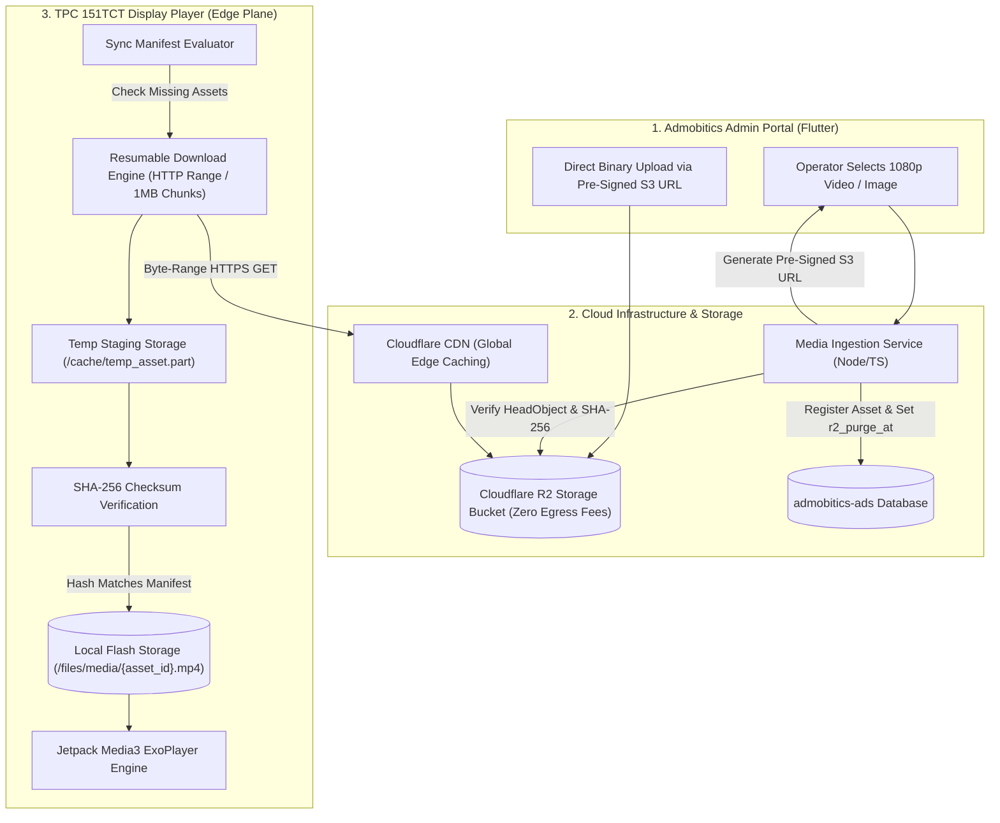
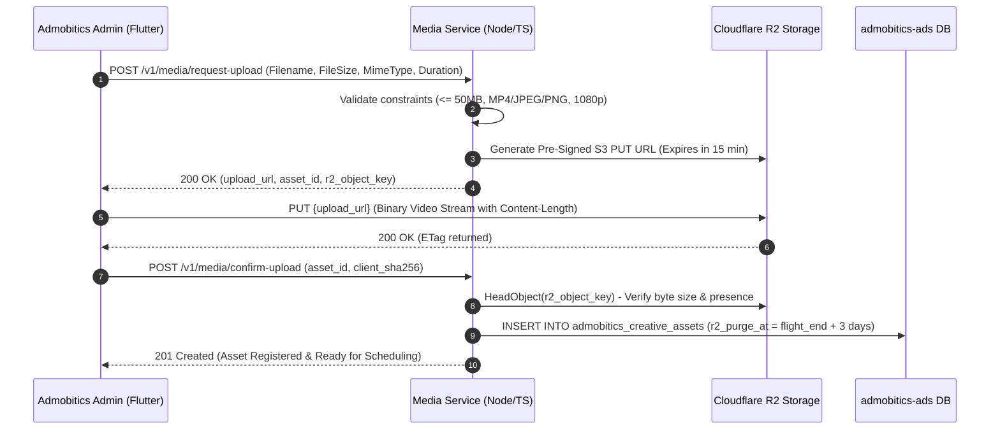
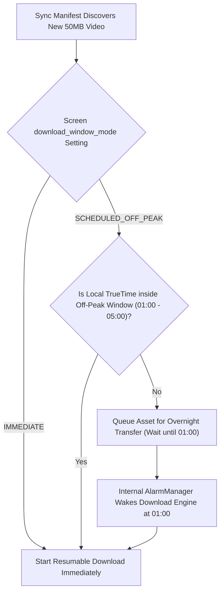
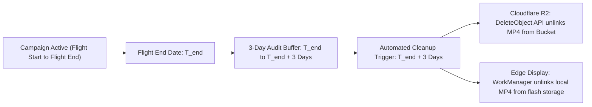

# FEAT-003: Media Delivery, Storage Lifecycle & Offline Synchronization

**Feature ID:** HINOPT-FEAT-003  
**Project:** HINOPT Advertising Software  
**Version:** 1.0.0 (Phase 1 Baseline)  
**Status:** Ratified Feature Specification  
**Classification:** Core Functional & Storage Specification  
**Authors:** Principal Software Architect (HINOPT)  
**Target Systems:** Admobitics Business Portal (`apps/business-admin`), Media Ingestion Service (`backend/media-service`), Cloudflare R2 Storage, Android Display Player (`apps/android-player`)  

---

## 1. Executive Summary & Media Pipeline Scope

This specification defines the complete end-to-end lifecycle of advertising media: from administrative upload in the **Admobitics Admin Portal (Flutter)**, direct ingestion into **Cloudflare R2 Object Storage**, pre-validation and cryptographic hashing, bandwidth-aware resumable edge downloads, local flash caching on the **TPC 151TCT**, to automated purge upon **Campaign End Date + 3 Days**.

It codifies the non-negotiable security invariant: **all media must enter the system through authorized backend delivery; physical USB media importation is permanently prohibited.**



---

## 2. Media Ingestion Architecture & Pre-Signed Cloudflare R2 Uploads

To avoid routing heavy 1080p video binaries through backend application servers, uploads utilize **direct-to-bucket pre-signed S3 URLs** generated by the Media Service:



### 2.1 Media Format Validation & Specification

Every uploaded file must strictly comply with the following hardware-compatible specifications:

| Parameter | Video Creative Specification | Static Image Specification |
| :--- | :--- | :--- |
| **Container / Format** | MP4 (MPEG-4 Part 14) | JPEG, PNG, or WebP |
| **Video Codec** | H.264 / AVC (Baseline, Main, or High Profile $\le$ Level 4.1) | N/A (Standard image bitmap) |
| **Audio Codec** | AAC-LC (Stereo or Mono, 44.1kHz or 48kHz) | N/A |
| **Resolution** | Exactly $1920 \times 1080$ pixels (16:9 aspect ratio) | Exactly $1920 \times 1080$ pixels |
| **Frame Rate** | 25 fps, 30 fps, or 60 fps (Constant Frame Rate) | N/A |
| **Maximum File Size** | 50 MB per creative | 10 MB per creative |
| **Checksum Algorithm** | SHA-256 (64 hex characters) | SHA-256 (64 hex characters) |

---

## 3. Edge Resumable Download Engine (Android Display Player)

The display player operates over commercial venue networks, which may experience intermittent drops or cellular signal fluctuation. The download engine must never discard partially downloaded files.

### 3.1 Download Protocol Mechanics

1. **Delta Discovery:** When a new `/sync-manifest` arrives, the player compares asset SHA-256 hashes against local flash storage. Only missing or modified assets are queued for download.
2. **Chunked Resumable Requests:** The player requests media using standard HTTP Range headers:
   ```http
   GET /assets/a9b8c7d6.mp4 HTTP/1.1
   Host: cdn.admobitics.hinopt.com
   Range: bytes=1048576-2097151
   If-Range: "v1-etag-hash"
   ```
   - Server responds with **`206 Partial Content`**.
   - If the connection drops at 45MB of a 50MB video, the player resumes at byte 47,185,920 upon reconnect, saving bandwidth and cellular data costs.
3. **Staging & Atomic Promotion:**
   - Active downloads write to `/data/data/com.hinopt.player/cache/temp_{asset_id}.part`.
   - Upon completion, the display reads the entire temporary file and computes its SHA-256 hash.
   - **If hash matches manifest:** Atomically renames the file to `/data/data/com.hinopt.player/files/media/{asset_id}.mp4` and marks `is_ready = true` in local Room SQLite.
   - **If hash mismatches:** Discards the corrupted staging file and retries up to 3 times before raising a telemetry warning.

---

## 4. Download Scheduling & Bandwidth Windows (Owner Configurable)

In accordance with our user-ratified decisions, the display respects an **Owner/Admin Choice in Settings** regarding when large media files are transferred:



### 4.1 Download Configuration Modes

1. **`IMMEDIATE`:** Begins downloading new media as soon as a new campaign is published. Recommended for venues with high-speed fiber Wi-Fi or Ethernet.
2. **`SCHEDULED_OFF_PEAK`:** Restricts large media transfers (> 10MB) to overnight off-peak hours (default: **01:00:00 to 05:00:00 local venue time**). Prevents consuming daytime cellular bandwidth in retail stores.
3. **Daytime Throttle (Optional):** If an urgent ad must be fetched during daytime hours on a cellular display, the admin can configure a rate ceiling (e.g., max 500 KB/s) to prevent cellular link saturation.

---

## 5. Storage Quota Management & Dynamic Watermark (TPC 151TCT)

The TPC 151TCT features **16GB eMMC storage**, of which approximately **6.0 to 8.0 GB** is usable user space after the Android 10 OS image and system apps.

```
+---------------------------------------------------------------+
|             16GB eMMC STORAGE PARTITION BUDGET                |
+---------------------------------------------------------------+
|  Android 10 OS + Vendor Firmware:  ~8.0 GB                    |
|  Reserved OS Buffer & SQLite WAL:  ~2.0 GB                    |
|  Dynamic Safe Watermark (30% Free): ~2.5 GB                   |
|  Usable HINOPT Media Storage Cache: ~3.5 - 5.0 GB             |
+---------------------------------------------------------------+
```

### 5.1 Dynamic Watermark Enforcement (30% Free Storage)

To guarantee that the flash storage is never filled to 100% (which would brick Android or cause OS-level database corruption):
1. **Continuous Space Inspection:** Before accepting any new download chunk, the player inspects `StatFs.getAvailableBytes()`.
2. **Safety Threshold:** The player requires at least **30% of user storage to remain free** (minimum $2.5\text{ GB}$).
3. **Automated LRU Cache Eviction:** If free space drops below 30%:
   - Queries local Room DB for unpinned media files whose campaigns have already ended.
   - Deletes files starting with the oldest last-played timestamp (Least Recently Used).
   - **Pinned Fallback Invariant:** Pre-cached House Loops and static logo images are marked `is_pinned = true` and **never** evicted.

---

## 6. The 3-Day Retention & Automated Purge Architecture

In accordance with our core architecture, media files are retained for the duration of the campaign **plus exactly 3 additional days** (dispute resolution and advertiser audit window), after which they are permanently deleted.



### 6.1 Backend Cloudflare R2 Deletion Worker

A daily scheduled cron job runs in the Media Service at 02:00:00 UTC:
1. Queries `admobitics_creative_assets` for expired, unpurged assets:
   ```sql
   SELECT asset_id, r2_object_key FROM admobitics_creative_assets
   WHERE r2_purge_at <= NOW() AND is_purged = FALSE;
   ```
2. For each asset, verifies that no other active or upcoming campaigns reference the same `r2_object_key`.
3. Issues `DeleteObject` command to the Cloudflare R2 bucket.
4. Updates database record: `is_purged = TRUE`.

### 6.2 Edge Player Local Storage Purge Worker

On the TPC 151TCT display, an Android `WorkManager` daily maintenance task executes:
1. Queries local Room SQLite:
   ```sql
   SELECT asset_id, local_file_path FROM cached_assets
   WHERE purge_after_datetime <= :currentTrueTime AND is_pinned = 0;
   ```
2. Unlinks the `.mp4` file from `/data/data/com.hinopt.player/files/media/`.
3. Deletes the asset record from the local Room database, reclaiming flash storage.

---

## 7. Acceptance Criteria (Gherkin Verification Scenarios)

```gherkin
Feature: Media Delivery, Resumable Downloads, and 3-Day Retention

  Scenario: Pre-signed direct upload to Cloudflare R2
    Given an authenticated Admobitics operator in the Flutter Admin Portal
    When the operator selects a compliant 1080p H.264 video file (24MB)
    Then the Media Service validates file size and video specs
    And returns a pre-signed Cloudflare R2 PUT URL with a 15-minute expiration
    When the portal streams the binary payload directly to Cloudflare R2
    And calls the upload confirmation endpoint with the client SHA-256 hash
    Then the backend verifies object existence and sets r2_purge_at to Flight End Date + 3 Days

  Scenario: Resumable chunked download survives network interruption
    Given an edge display downloading a 40MB video asset
    When 20MB has been downloaded to the staging partition and network drops
    And network connectivity is restored 10 minutes later
    Then the display download engine resumes from byte offset 20,971,520 using HTTP Range headers
    And does not re-download the first 20MB of data
    When download completes, the display validates the full SHA-256 checksum
    And atomically moves the file to permanent media storage

  Scenario: Scheduled off-peak download window enforcement
    Given a screen configured with download_window_mode "SCHEDULED_OFF_PEAK" (01:00 - 05:00)
    When a new 50MB campaign asset is published at 14:00:00 local time
    Then the display defers downloading the heavy video during daytime hours
    When local TrueTime reaches 01:00:00
    Then the background download engine wakes and downloads the media asset before morning flight

  Scenario: Automated Cloudflare R2 and edge flash storage purge
    Given a campaign that ended on December 15
    And the retention buffer extends until December 18 at 23:59:59 (End Date + 3 Days)
    When the daily cleanup worker runs on December 19
    Then the Cloudflare R2 object is permanently deleted via S3 DeleteObject API
    And the edge display WorkManager unlinks the local MP4 file from internal flash storage
    And the pinned fallback house loop video remains untouched
```

---

*HINOPT Advertising Software Specification — End of FEAT-003*
