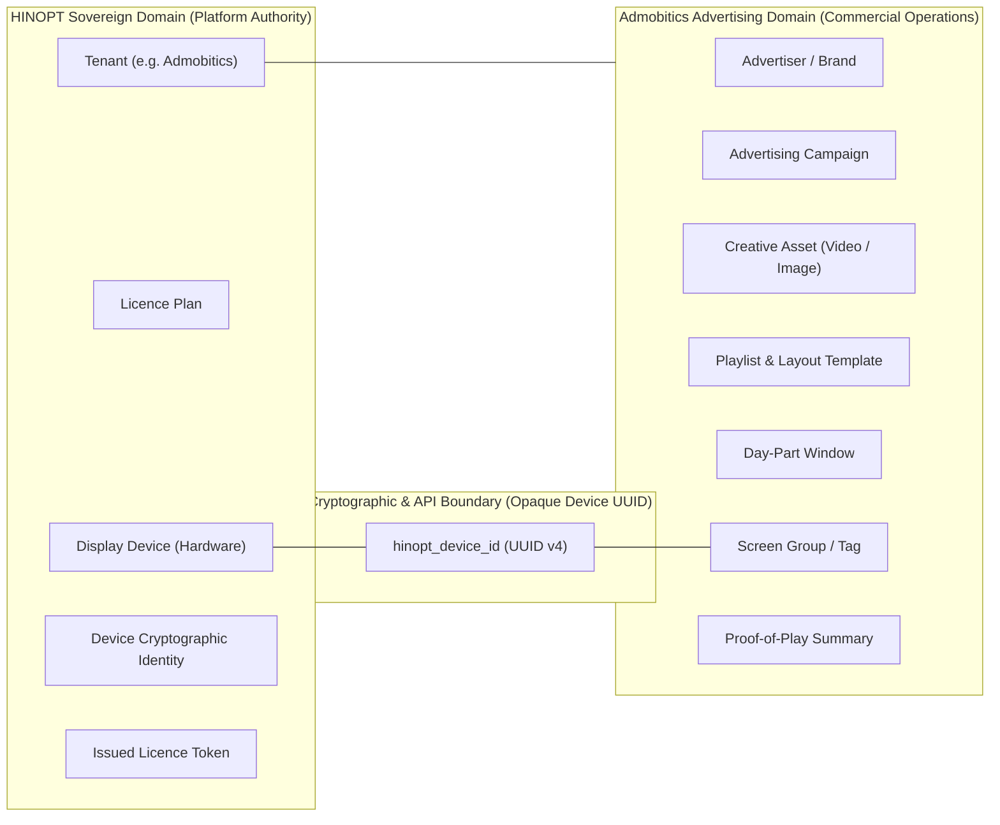
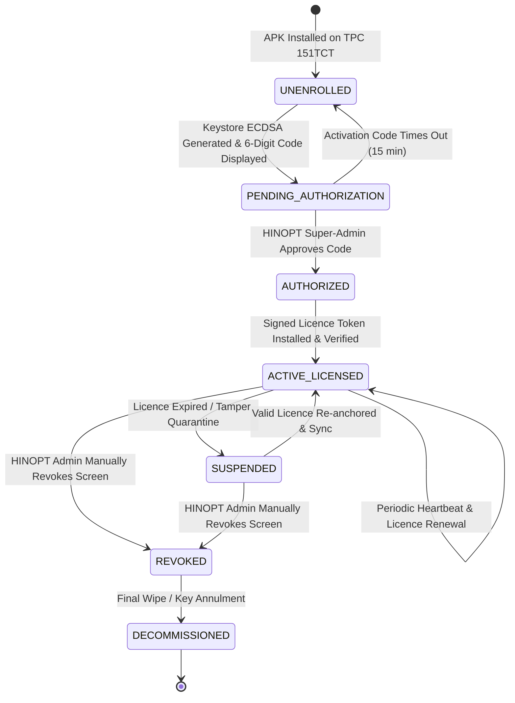
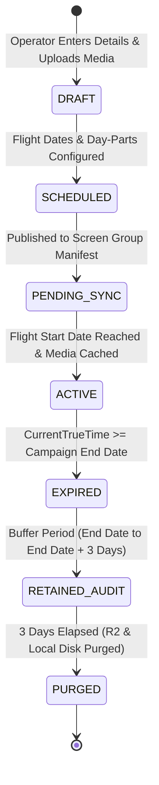
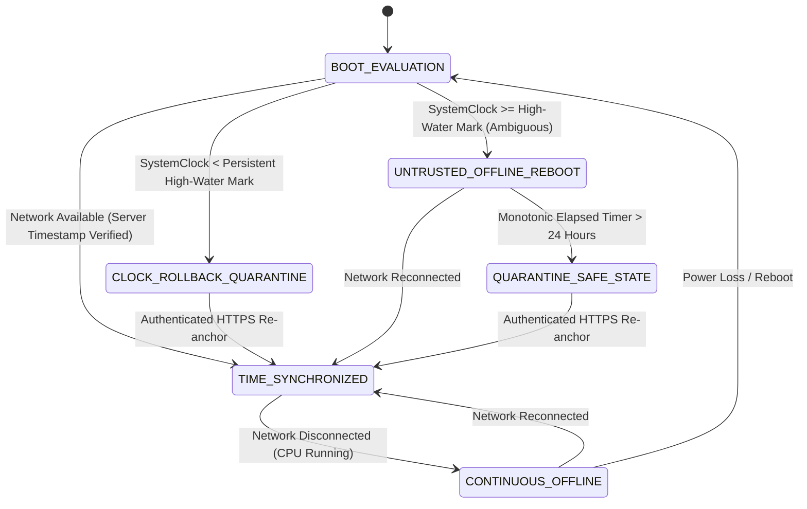
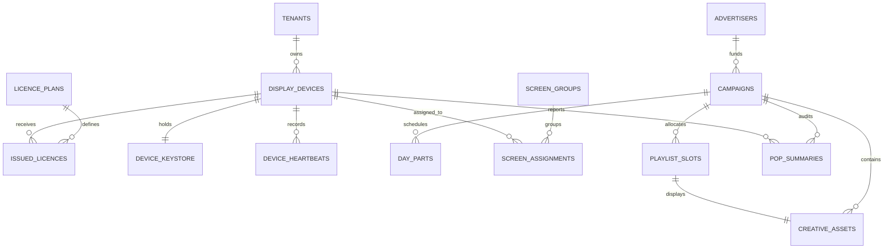

# PRD-001: Core Domain Model & Signage Terminology

**Document ID:** HINOPT-PRD-001  
**Project:** HINOPT Advertising Software  
**Version:** 1.0.0 (Phase 1 Baseline)  
**Status:** Ratified Specification  
**Classification:** Core Engineering Standard  
**Authors:** Principal Software Architect (HINOPT)  
**Stakeholders:** HINOPT Platform Engineering, Admobitics Operations  

---

## 1. Purpose & Scope

This Product Requirements Document (PRD) establishes the **Ubiquitous Language**, **Domain Model**, **Entity Invariants**, and **System State Machines** for the **HINOPT Advertising Software** platform.

Every subsequent specification, database migration, API contract, and software module must strictly adhere to the definitions and domain boundaries codified in this document.

---

## 2. Ubiquitous Domain Vocabulary

The system is strictly divided into two distinct domains: the **HINOPT Sovereign Domain** and the **Admobitics Advertising Domain**.

### 2.1 HINOPT Sovereign Domain Terminology

| Term | Definition |
| :--- | :--- |
| **Platform Owner** | **HINOPT Technologies**. The legal and technical entity with sole authority over software licensing, device cryptographic identity, and platform integrity. |
| **Tenant** | An organizational customer operating an advertising network on HINOPT infrastructure (specifically **Admobitics** in Phase 1). |
| **Display Device** | A physical hardware touch terminal running Android 10 (specifically the **TPC 151TCT**). Uniquely identified by an opaque UUID assigned by HINOPT (`hinopt_device_id`). |
| **Device Cryptographic Identity** | An asymmetric **ECDSA P-256** key pair generated inside the device's hardware-backed `AndroidKeyStore` during initial enrollment. The private key never leaves the device. |
| **Activation Code** | A short, cryptographically randomized 6-character alphanumeric string generated by an un-enrolled device and displayed on-screen for administrative pairing. Expire after 15 minutes. |
| **Licence Plan** | A commercial entitlement tier defined by HINOPT governing device capabilities (e.g., max concurrent screens, feature flags, support level). |
| **Issued Licence** | A cryptographically signed **Ed25519 token** issued by HINOPT to a specific `hinopt_device_id`, containing validity timestamps (`valid_from`, `valid_until`), plan claims, and tenant attribution. |
| **Device Heartbeat** | Periodic telemetry payload transmitted by a display to HINOPT containing hardware health indicators (CPU temperature, RAM usage, storage free, app uptime, error flags). |

### 2.2 Admobitics Commercial Domain Terminology

| Term | Definition |
| :--- | :--- |
| **Advertiser** | A commercial client of Admobitics who purchases ad exposure on screens (e.g., brands, local businesses). |
| **Campaign** | A time-bounded, commercial advertising contract. Contains budget, flight dates (`start_date`, `end_date`), target screen groups, and associated creatives. |
| **Creative Asset** | A single media file (1080p MP4 video or high-resolution JPEG/PNG/WebP image) approved for playback. Uniquely identified by an immutable `asset_id` and SHA-256 hash. |
| **Day-Part Window** | A scheduled recurring time slot within a day (e.g., Monday–Friday from 08:00:00 to 12:00:00) during which a campaign is active. |
| **Playlist** | An ordered, deterministic sequence of playable items (slots) compiled for a specific screen or screen group. |
| **Playlist Slot** | A single playback unit in a playlist loop. Has a defined duration (native video length or fixed image display time) and weight (Share-of-Voice multiplier). |
| **Screen Group** | A logical clustering of displays sharing geographic, demographic, or venue attributes (e.g., "Airport Terminal 3", "Metro Station Concourses"). |
| **Proof-of-Play (PoP) Summary** | An aggregated audit record compiled locally by the display, tracking total impressions, total playback seconds, and completion counts per campaign per day/deadline. |
| **House Loop (Fallback)** | A pre-cached default media loop or branded content played when no commercial campaigns are scheduled or when all active campaigns have expired. |

---

## 3. Core Entity Invariants & Business Rules

### 3.1 Sovereign Licensing Invariants (HINOPT)

1. **Sovereign Authorization Rule:** No display player may render commercial advertising without a cryptographically valid, unexpired **HINOPT Licence Token**.
2. **Key Exclusivity Rule:** HINOPT private signing keys must reside strictly in HINOPT cloud key management (KMS/HSM). Under no circumstances may Admobitics systems or Android APK binaries contain HINOPT private keys.
3. **Tenant Access Boundary:** Admobitics administrators and database service roles have **zero read or write access** to `hinopt-core` database tables, device public keys, or licence issuance APIs.
4. **Offline Revocation Invariant:** Licence revocation takes effect upon the **next successful HTTPS synchronization**. If a device remains offline, it is governed strictly by the local cryptographic `valid_until` timestamp in its signed licence. Immediate offline revocation is physically impossible and must not be claimed.

### 3.2 Advertising & Playback Invariants (Admobitics)

1. **Deterministic Local Expiry:** Campaign expiration is evaluated locally on the edge display. When `CurrentTrueTime > campaign.end_datetime`, the campaign is immediately dropped from the playback loop, regardless of whether internet connectivity is present.
2. **Decoupled Failure Modes:**
   - Expiry of a single Admobitics campaign affects **only that campaign**. Other valid campaigns continue to play.
   - Expiry of all Admobitics campaigns causes the player to revert to the screen owner's configured **Fallback Mode** (House Loop, Static Image, or Black Screen).
   - Expiry of the HINOPT Master Licence halts **all advertising operations entirely** and displays the HINOPT unlicenced screen.
3. **Zero USB Ingress:** Media assets can enter the system **only** through authenticated uploads via the Admobitics Admin Portal, validated by the backend, stored in Cloudflare R2, and fetched over HTTPS. USB flash drive importing is permanently disabled.
4. **Media Retention Rule:** Media files remain in Cloudflare R2 and on local display storage for the duration of the campaign **plus exactly 3 additional days** (retention/audit window). Upon $T_{\text{end}} + 3\text{ days}$, files are automatically purged.

---

## 4. System State Machines

### 4.1 Device Lifecycle State Machine (HINOPT Authority)

### 4.2 Campaign Lifecycle State Machine (Admobitics Operations)

### 4.3 4-State Offline Time Security Machine (Edge Player)

---

## 5. Screen Configuration Matrix (User-Ratified Settings)

Based on direct product constraints, each screen supports four independent administrative configuration policies set by the Screen Owner / Admin before campaign deployment:

### 5.1 Empty Loop / Fallback Policy (`fallback_mode`)
When no commercial campaigns are scheduled during a time slot:
- `HOUSE_LOOP`: Continuously plays a pre-cached brand awareness loop.
- `STATIC_IMAGE`: Displays a designated high-resolution branded graphic.
- `BLACK_SCREEN`: Enters a power-saving standby display with backlight disabled or pure black canvas.

### 5.2 Audio Output Policy (`audio_policy`)
- `MUTED_GLOBAL`: All videos are played with master audio hardware muted (`volume = 0.0`).
- `ENABLED_WITH_LIMIT`: Audio tracks play at a defined ceiling (`max_volume_pct`, e.g., 60%).
- `SCHEDULED_AUDIO`: Audio is enabled during daytime business hours (e.g., 09:00–21:00) and automatically muted overnight.

### 5.3 Playlist Rotation Policy (`rotation_policy`)
- `ROUND_ROBIN`: All active campaigns in the window play sequentially in fair rotation:
  $$\text{Loop} = [C_1, C_2, C_3, \dots, C_n]$$
- `WEIGHTED_SOV` (Share of Voice): Campaigns with higher purchased frequency play multiple slots per loop based on their assigned weight:
  $$\text{Example (Weight } C_1=2, C_2=1\text{)} \implies [C_1, C_2, C_1]$$

### 5.4 Screen Canvas Layout (`layout_mode`)
- `FULL_SCREEN_1080P`: Single full-bleed $1920 \times 1080$ viewport for video or image.
- `SPLIT_SCREEN_DUAL_VIDEO`: Main primary video zone ($1280 \times 720$ or $1920 \times 800$) + secondary companion video/animation zone.
- `SPLIT_SCREEN_TICKER`: Main video zone ($1920 \times 960$) + bottom real-time scrolling text ticker ($1920 \times 120$).

---

## 6. Proof-of-Play (PoP) Ingestion Specification

### 6.1 Summary Aggregation Model (Method 2)

To preserve network bandwidth and prevent database write bloat, Phase 1 enforces **Method 2 (Aggregated Counters)**:

1. **Local Real-Time Tallying:** During continuous playback, the display increments internal counters in its local Room SQLite database for each campaign slot:
   - `impressions_count`: Number of times the creative played to completion ($>95\%$ duration).
   - `total_duration_seconds`: Cumulative seconds rendered on screen.
   - `skipped_or_interrupted_count`: Instances where an error or power cycle cut playback short.
2. **Offline Resilience:** PoP summaries accumulate safely in local SQLite storage during network outages. No data is lost.
3. **Upload Trigger Policy (`pop_upload_trigger`):** Configurable per screen/admin:
   - `DAILY_END_OF_DAY`: Uploads a single aggregated payload daily at 23:59:00 (or on first reconnect).
   - `CAMPAIGN_DEADLINE`: Flushes final campaign counters immediately upon local campaign expiration.

---

## 7. Data Models & Entity Relationships

---

## 8. Requirements Traceability Matrix

| Requirement ID | Description | Primary Component | Verification Method |
| :--- | :--- | :--- | :--- |
| **PRD-001-REQ-01** | Dual Supabase project isolation for licensing vs advertising | Backend Infrastructure | Security Penetration Audit |
| **PRD-001-REQ-02** | Keystore ECDSA P-256 device request signing | Android Display Player | Cryptographic Unit Test |
| **PRD-001-REQ-03** | 4-State Time Machine with 24-hour untrusted reboot grace ceiling | Android Display Player | Clock Rollback Simulation |
| **PRD-001-REQ-04** | Local campaign expiry independent of network connectivity | Android Display Player | Network Disconnect Test |
| **PRD-001-REQ-05** | Configurable screen fallback (House Loop, Image, Black Screen) | Android / Admin Portal | UI Configuration Test |
| **PRD-001-REQ-06** | Screen audio policy (Muted, Enabled, Scheduled) | Android Display Player | Audio Output Hardware Test |
| **PRD-001-REQ-07** | Dual rotation support (Round-Robin vs Weighted SOV) | Schedule Engine | Algorithmic Simulation |
| **PRD-001-REQ-08** | PoP aggregated summaries with daily or deadline upload | Android Room DB / Backend | Ingestion Load Test |
| **PRD-001-REQ-09** | Cloudflare R2 media retention: Campaign End Date + 3 Days | Backend Media Service | Storage Lifecycle Audit |
| **PRD-001-REQ-10** | Non-destructive universal APK installation on TPC 151TCT | Android Display Player | On-Site Provisioning Test |

---

*HINOPT Advertising Software Specification — End of PRD-001*
