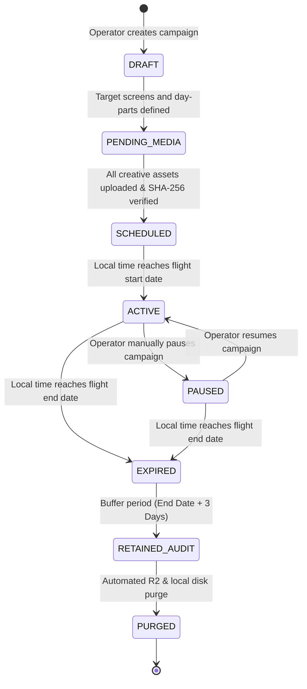
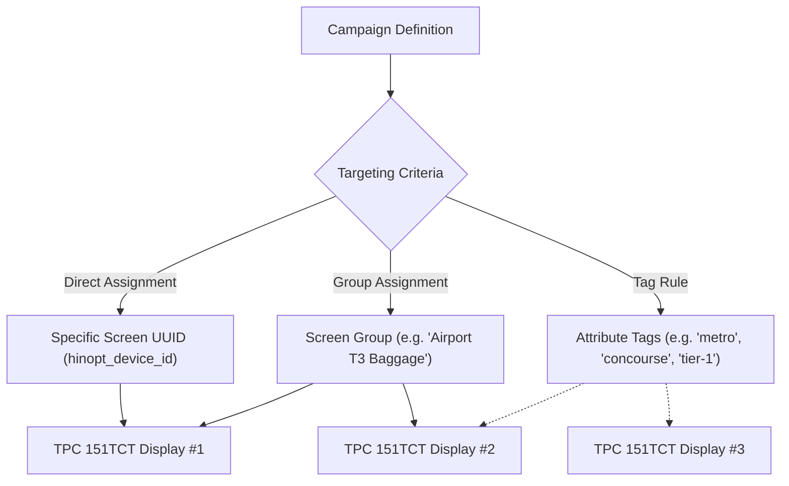
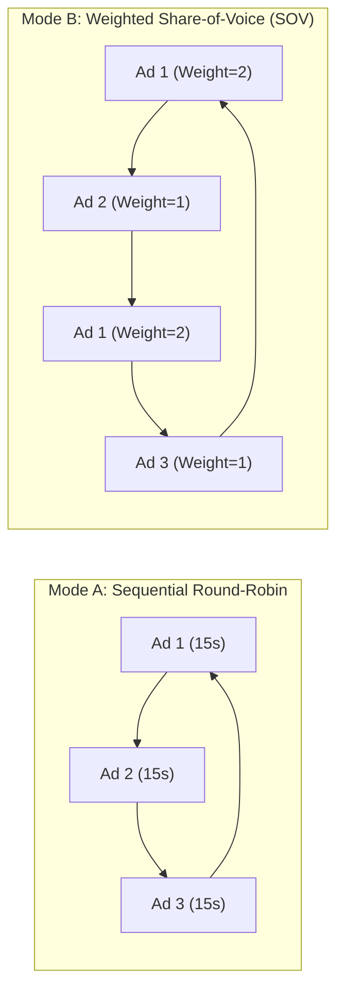
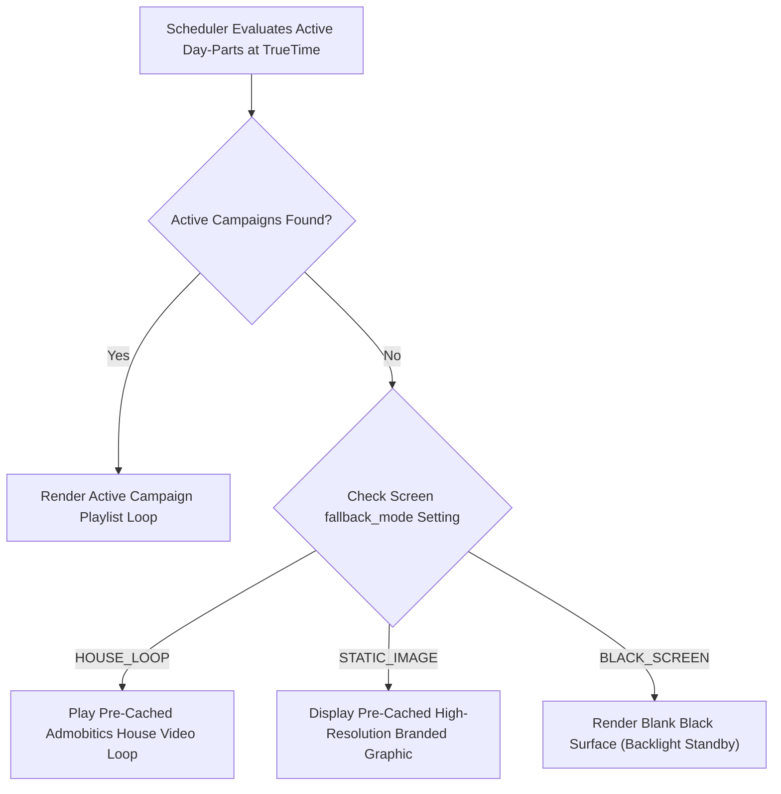

# PRD-002: Campaign Scheduling & Day-Parting Engine

**Document ID:** HINOPT-PRD-002  
**Project:** HINOPT Advertising Software  
**Version:** 1.0.0 (Phase 1 Baseline)  
**Status:** Ratified Specification  
**Classification:** Core Engineering Standard  
**Authors:** Principal Software Architect (HINOPT)  
**Stakeholders:** HINOPT Platform Engineering, Admobitics Operations  

---

## 1. Purpose & Scope

This specification defines the functional requirements, data structures, scheduling algorithms, and manifest delivery contracts for the **Admobitics Campaign Scheduling & Day-Parting Engine**.

It details how advertising campaigns are scheduled across flights, partitioned by day-of-week and time-of-day, resolved into deterministic screen playlists, compiled into cacheable sync manifests, and executed offline on the **TPC 151TCT** display player.

---

## 2. Campaign Flight Lifecycle

An advertising campaign represents a commercial contract between an **Advertiser** and **Admobitics**. It operates through a deterministic lifecycle:



### 2.1 Campaign Attributes & Validation Rules

| Field | Type | Description & Constraint |
| :--- | :--- | :--- |
| `campaign_id` | UUID v4 | Unique immutable campaign identifier. |
| `advertiser_id` | UUID v4 | Reference to the booking advertiser in Admobitics DB. |
| `name` | String(120) | Human-readable campaign title. |
| `flight_start_date` | Date (YYYY-MM-DD) | Calendar start date in the display screen's local time zone. |
| `flight_end_date` | Date (YYYY-MM-DD) | Calendar end date in the display screen's local time zone (inclusive). |
| `priority_tier` | Enum | `STANDARD` (default commercial), `SPONSOR` (high-weight), `EMERGENCY` (override). |
| `status` | Enum | `DRAFT`, `SCHEDULED`, `ACTIVE`, `PAUSED`, `EXPIRED`, `ARCHIVED`. |
| `created_at` | Timestamp | UTC timestamp of creation. |
| `updated_at` | Timestamp | UTC timestamp of latest mutation (triggers `manifest_version` increment). |

---

## 3. Day-Parting Matrix & Scheduling Windows

Commercial digital signage requires targeting ads to specific hours when target audiences are present (e.g., breakfast hours in transit hubs vs. evening hours in retail centers).

### 3.1 Day-Part Data Structure

Each campaign contains one or more `day_part_windows`:

```json
{
  "day_part_id": "8f3e2b1a-9c4d-4e5f-b6a7-1c2d3e4f5a6b",
  "days_of_week": ["MONDAY", "TUESDAY", "WEDNESDAY", "THURSDAY", "FRIDAY"],
  "start_time": "08:00:00",
  "end_time": "12:00:00"
}
```

### 3.2 Day-Parting Execution Rules

1. **Local Time Evaluation:** All day-part time comparisons (`start_time` and `end_time`) are evaluated against the **display device's local clock** (anchored via the 4-State Time Machine).
2. **Boundary Precision:** Time windows are evaluated with second-level precision:
   $$\text{IsActive}(t) \iff t \ge \text{start\_time} \land t < \text{end\_time}$$
3. **Disjoint & Multiple Windows:** A campaign may declare non-contiguous day-parts (e.g., Morning: 07:00–10:00 AND Evening: 17:00–21:00).
4. **Mid-Play Boundary Policy:** If an ad slot starts playing at 11:59:50 with a 15-second duration, and the day-part ends at 12:00:00:
   - **Policy:** The currently rendering slot is allowed to complete its full duration (until 12:00:05) to prevent jarring visual cuts.
   - Upon completion, the scheduler immediately transitions to the next scheduled window or fallback loop.

---

## 4. Screen Targeting & Grouping Topology

Displays are mapped to campaigns through a hierarchical targeting topology:



### 4.1 Targeting Hierarchy & Precedence
1. **Direct Screen Assignment:** Explicitly binds a campaign to a specific `hinopt_device_id`.
2. **Screen Group Assignment:** Binds a campaign to all displays belonging to a `group_id`.
3. **Tag-Based Assignment:** Binds to all displays possessing matching key-value tags (e.g., `city: "mumbai"` AND `venue: "retail"`).
4. **Resolution Invariant:** The backend evaluates the set union of all matching rules when compiling the screen's sync manifest. Duplicate assignments are deduplicated so a creative never plays twice in the same loop position.

---

## 5. Playlist Compilation & Rotation Engine

### 5.1 Dual Rotation Models (User-Ratified)

When multiple campaigns match an active day-part window on a screen, the scheduler rotates slots according to the screen's administrative `rotation_policy`:



#### Mode A: Sequential Round-Robin
- Every active campaign receives exactly one slot in the loop.
- Slot sequence: $[C_1, C_2, C_3, \dots, C_n]$.
- Loop duration: $T_{\text{loop}} = \sum_{i=1}^n \text{duration}(C_i)$.

#### Mode B: Weighted Share-of-Voice (SOV)
- Advertisers can purchase higher frequency by assigning a slot weight integer $w_i \in [1, 5]$.
- **Even Distribution Algorithm:** To avoid clustering (e.g., playing $C_1$ twice consecutively), the engine distributes weighted slots evenly throughout the loop using a largest-remainder interleaving algorithm:
  $$\text{Target Loop Sequence: } [C_1, C_2, C_1, C_3]$$

---

## 6. Empty Loop & Fallback Policy Resolution

When no commercial campaigns are active (due to an unscheduled overnight gap, campaign flight end, or network delay):



- **Zero Black Screen Invariant:** Unless explicitly set to `BLACK_SCREEN`, the player must never display a blank display, OS desktop, or error message. It seamlessly transitions to the configured fallback asset.
- **Fallback Pre-caching:** The house loop video or static image is downloaded during device enrollment and pinned permanently in local storage (exempt from LRU cache eviction).

---

## 7. Display Canvas Layout Templates

The admin can configure the screen layout mode before campaign deployment:

```
+-------------------------------------------------------+
|                1. FULL_SCREEN_1080P                   |
|                                                       |
|                                                       |
|               1920 x 1080 Full Bleed                  |
|               (Video or Static Image)                 |
|                                                       |
|                                                       |
+-------------------------------------------------------+

+-------------------------------------------------------+
|             2. SPLIT_SCREEN_DUAL_VIDEO                |
|  +--------------------------------+ +---------------+ |
|  |                                | |               | |
|  |     Primary Video Zone         | | Companion Zone| |
|  |       1280 x 720               | |  640 x 720    | |
|  |                                | | (Video/Graphic| |
|  +--------------------------------+ +---------------+ |
+-------------------------------------------------------+

+-------------------------------------------------------+
|               3. SPLIT_SCREEN_TICKER                  |
|  +-------------------------------------------------+  |
|  |                                                 |  |
|  |             Main Video Zone (1920 x 960)        |  |
|  |                                                 |  |
|  +-------------------------------------------------+  |
|  |  Scrolling Text Ticker / RSS Feed (1920 x 120)  |  |
+-------------------------------------------------------+
```

---

## 8. The Sync Manifest Contract (`/sync-manifest`)

### 8.1 API Request & Efficient Caching

Displays poll the Admobitics backend over HTTPS REST:

```http
GET /v1/displays/{hinopt_device_id}/sync-manifest HTTP/1.1
Host: api.admobitics.hinopt.com
X-Device-Signature: <ECDSA_P256_Signature>
If-None-Match: "v1731845400-sha256hash"
```

- **Efficient ETag & Version Checking:** The backend compares `If-None-Match` against the screen's cached manifest hash. If unchanged, it returns **`304 Not Modified`** with zero response body, eliminating database queries across campaigns, playlists, and creatives.

### 8.2 Manifest JSON Payload Schema

When updates exist, the backend returns **`200 OK`**:

```json
{
  "manifest_version": 1731845400,
  "generated_at": "2026-11-17T12:00:00Z",
  "screen_settings": {
    "display_id": "d4e5f6a7-b8c9-4d0e-1f2a-3b4c5d6e7f8a",
    "fallback_mode": "HOUSE_LOOP",
    "audio_policy": "SCHEDULED_AUDIO",
    "audio_schedule": { "start": "09:00:00", "end": "21:00:00", "max_volume_pct": 70 },
    "rotation_policy": "WEIGHTED_SOV",
    "layout_mode": "FULL_SCREEN_1080P",
    "pop_upload_trigger": "DAILY_END_OF_DAY"
  },
  "campaigns": [
    {
      "campaign_id": "c1a2b3c4-d5e6-4f7a-8b9c-0d1e2f3a4b5c",
      "flight_start_date": "2026-12-01",
      "flight_end_date": "2026-12-15",
      "weight": 2,
      "day_parts": [
        {
          "days_of_week": ["MONDAY", "WEDNESDAY", "FRIDAY"],
          "start_time": "08:00:00",
          "end_time": "14:00:00"
        }
      ],
      "creatives": [
        {
          "asset_id": "a9b8c7d6-e5f4-4a3b-2c1d-0e9f8a7b6c5d",
          "media_type": "VIDEO",
          "duration_seconds": 15,
          "file_size_bytes": 18452100,
          "sha256": "e3b0c44298fc1c149afbf4c8996fb92427ae41e4649b934ca495991b7852b855",
          "download_url": "https://cdn.admobitics.hinopt.com/assets/a9b8c7d6.mp4"
        }
      ]
    }
  ],
  "fallback_asset": {
    "asset_id": "house-loop-default-v1",
    "media_type": "VIDEO",
    "duration_seconds": 30,
    "sha256": "8f434346648f6b96df89dda901c5176b10a6d83961dd3c1ac88b59b2dc327aa4",
    "download_url": "https://cdn.admobitics.hinopt.com/assets/house-loop-default-v1.mp4"
  }
}
```

---

## 9. Proof-of-Play (PoP) Aggregated Ingestion Model

In accordance with our ratified architecture, the display tracks aggregated summary counters in local Room SQLite:

```sql
CREATE TABLE proof_of_play_summaries (
    id TEXT PRIMARY KEY,
    hinopt_device_id TEXT NOT NULL,
    campaign_id TEXT NOT NULL,
    asset_id TEXT NOT NULL,
    reporting_date TEXT NOT NULL,       -- YYYY-MM-DD
    impressions_count INTEGER NOT NULL DEFAULT 0,
    total_seconds_played INTEGER NOT NULL DEFAULT 0,
    interrupted_count INTEGER NOT NULL DEFAULT 0,
    first_play_timestamp TEXT NOT NULL,
    last_play_timestamp TEXT NOT NULL,
    is_uploaded INTEGER NOT NULL DEFAULT 0
);
```

### 9.1 Upload Payload

When triggered (daily at 23:59:00 or upon campaign deadline), the display sends:

```http
POST /v1/displays/{hinopt_device_id}/playback-reports HTTP/1.1
Host: api.admobitics.hinopt.com
Content-Type: application/json
X-Device-Signature: <ECDSA_P256_Signature>

{
  "report_batch_id": "b1c2d3e4-f5a6-4b7c-8d9e-0f1a2b3c4d5e",
  "hinopt_device_id": "d4e5f6a7-b8c9-4d0e-1f2a-3b4c5d6e7f8a",
  "summaries": [
    {
      "campaign_id": "c1a2b3c4-d5e6-4f7a-8b9c-0d1e2f3a4b5c",
      "asset_id": "a9b8c7d6-e5f4-4a3b-2c1d-0e9f8a7b6c5d",
      "reporting_date": "2026-12-01",
      "impressions_count": 48,
      "total_seconds_played": 720,
      "interrupted_count": 0,
      "first_play_timestamp": "2026-12-01T08:02:15Z",
      "last_play_timestamp": "2026-12-01T13:58:30Z"
    }
  ]
}
```

Upon receiving **`202 Accepted`**, the display marks rows as `is_uploaded = 1`, and the local daily WorkManager task safely archives them.

---

## 10. Requirements Traceability Matrix (PRD-002)

| Requirement ID | Description | Target Component | Verification Method |
| :--- | :--- | :--- | :--- |
| **PRD-002-REQ-01** | Flight date evaluation with second-level boundary accuracy | Edge Scheduler | Unit Test with Clock Simulation |
| **PRD-002-REQ-02** | Day-parting evaluation using local true time | Edge Scheduler | Time Zone Offset Test |
| **PRD-002-REQ-03** | Sequential Round-Robin loop compilation | Edge Scheduler | Playlist Unit Test |
| **PRD-002-REQ-04** | Weighted Share-of-Voice interleaving algorithm | Edge Scheduler | Rotation Distribution Test |
| **PRD-002-REQ-05** | Seamless fallback to House Loop / Graphic on empty window | Media3 Engine | Offline Disconnect Simulation |
| **PRD-002-REQ-06** | Audio policy enforcement (mute schedule & volume limit) | Media3 Engine | Audio Hardware Output Test |
| **PRD-002-REQ-07** | ETag & `manifest_version` 304 caching | Backend API | HTTP Load Benchmark |
| **PRD-002-REQ-08** | Resumable chunked media download with SHA-256 verification | Android Download Manager | Network Partition Simulation |
| **PRD-002-REQ-09** | Aggregated PoP counter tracking in local Room DB | Android Room DB | Power Loss Stress Test |
| **PRD-002-REQ-10** | End Date + 3 Days automated media purge | Backend Media Service | Storage Retention Audit |

---

*HINOPT Advertising Software Specification — End of PRD-002*
