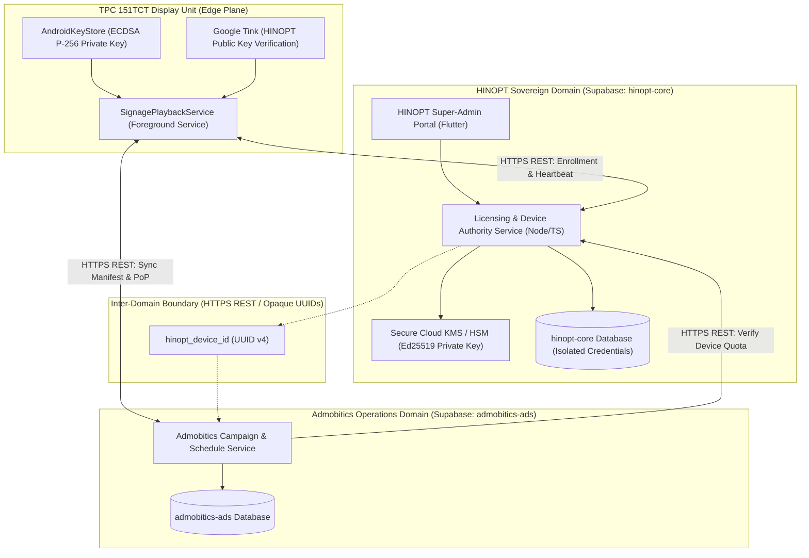
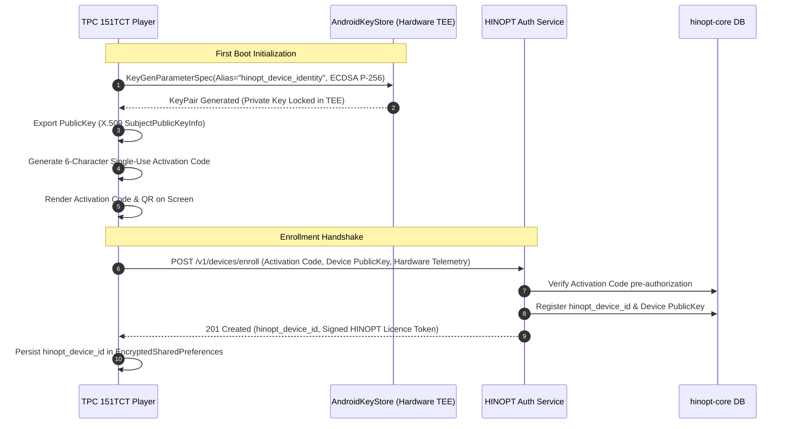
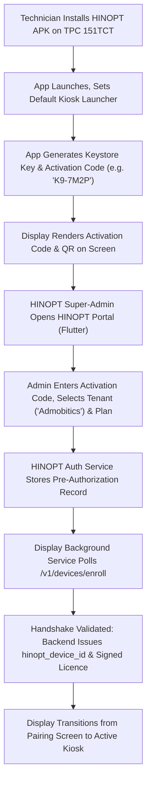
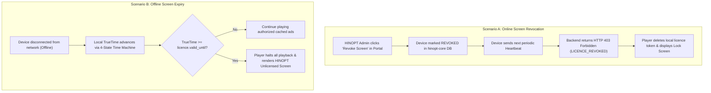

# PRD-003: HINOPT Master Licensing & Device Authority

**Document ID:** HINOPT-PRD-003  
**Project:** HINOPT Advertising Software  
**Version:** 1.0.0 (Phase 1 Baseline)  
**Status:** Ratified Specification  
**Classification:** Core Engineering Standard  
**Authors:** Principal Software Architect (HINOPT)  
**Stakeholders:** HINOPT Platform Engineering, Admobitics Operations  

---

## 1. Purpose & Scope

This specification defines the cryptographic foundations, device enrollment workflows, authentication protocols, telemetry pipelines, and master licensing rules governed by the **HINOPT Sovereign Authority**.

It establishes the non-negotiable security boundaries that guarantee HINOPT's sovereignty over all edge displays and enforce total isolation between HINOPT's licensing infrastructure and Admobitics' advertising operations.

---

## 2. Sovereign Authority & Security Boundaries



### 2.1 Non-Negotiable Security Invariants

1. **Private Key Segregation:** The HINOPT Ed25519 private signing key resides strictly within HINOPT Cloud Key Management Service (KMS) or hardware security modules (HSM). It is **never** shared with Admobitics, never stored in source code, and never deployed to edge devices.
2. **Database Isolation:** HINOPT licensing tables reside in a physically isolated Supabase project (`hinopt-core`). Admobitics administrators, services, and database credentials have **zero network or database access** to `hinopt-core`.
3. **Display Pre-requisite Rule:** An edge display cannot pull campaigns or register with Admobitics until it holds a valid, cryptographically verified HINOPT licence token.
4. **Opaque Identification:** Admobitics systems reference physical displays solely by an opaque `hinopt_device_id` UUID issued by HINOPT. Admobitics cannot mint, authorize, or reissue device identities.

---

## 3. Cryptographic Device Identity Architecture

Modern Android (Android 10+) restricts access to non-resettable hardware identifiers (`Build.getSerial()` requires privileged permissions; MAC addresses are randomized). Device identity is therefore established cryptographically via hardware-backed asymmetric keys.



### 3.1 Device Key Specification

- **Algorithm:** **ECDSA with NIST P-256 Curve (`secp256r1`)** using `SHA256withECDSA`.
- **Key Storage:** Stored in `AndroidKeyStore` with `PURPOSE_SIGN` and `PURPOSE_VERIFY`.
- **Hardware Protection:** Bound to the hardware-backed Trusted Execution Environment (TEE) or StrongBox if present on the TPC 151TCT ARMv8 SoC. The private key cannot be extracted or exported.
- **Request Authentication:** Every subsequent HTTP request sent by the display includes a cryptographic signature in the `X-Device-Signature` header, computed over the HTTP method, request path, timestamp, and body hash.

---

## 4. The 6-Digit Activation Code & Pairing Workflow

The onboarding workflow supports brand-new factory displays as well as screens with existing software, without requiring a destructive factory wipe.



### 4.1 Activation Code Security Rules

1. **Character Set:** 6 characters selected from an unambiguous alphanumeric alphabet (`23456789ABCDEFGHJKLMNPQRSTUVWXYZ`), excluding confusing glyphs (`0`, `O`, `1`, `I`, `L`).
2. **Entropy:** Over 1 billion possible combinations ($32^6 = 1,073,741,824$), preventing brute-force enumeration.
3. **Expiration:** Activation codes expire after **15 minutes**. If unclaimed, the display automatically destroys the code and generates a fresh one.
4. **Single-Use Invariant:** Once paired, an activation code is permanently burned in the database and cannot be reused.

---

## 5. Cryptographic Licence Token Specification

HINOPT software licences are distributed as compact, tamper-evident cryptographic tokens.

### 5.1 Token Format: Signed Ed25519 JWT

- **Header:**
  ```json
  {
    "alg": "EdDSA",
    "typ": "JWT",
    "kid": "hinopt-root-2026-v1"
  }
  ```
- **Payload (Claims):**
  ```json
  {
    "iss": "https://authority.hinopt.com",
    "sub": "d4e5f6a7-b8c9-4d0e-1f2a-3b4c5d6e7f8a",
    "aud": "hinopt-display-player",
    "tenant_id": "admobitics",
    "plan_tier": "ENTERPRISE",
    "valid_from": 1733011200,
    "valid_until": 1735689600,
    "clock_max_skew_seconds": 300,
    "features": [
      "FULL_SCREEN_1080P",
      "SPLIT_SCREEN_ZONES",
      "OFFLINE_PLAYBACK_24H",
      "HARDWARE_WATCHDOG"
    ],
    "jti": "e1f2a3b4-c5d6-4e7f-8a9b-0c1d2e3f4a5b"
  }
  ```
- **Signature:** 64-byte Ed25519 signature computed over `Base64URL(Header).Base64URL(Payload)`.

### 5.2 Edge Verification via Google Tink (Android 10)

Because native `AndroidKeyStore` supports Ed25519 only in Android 12+, the Android display player verifies HINOPT licence signatures in user-space using **Google Tink** (`com.google.crypto.tink:tink-android`):
- The HINOPT public verification key is embedded directly into the application bytecode.
- Verification is performed locally with zero network calls in under 5 milliseconds.
- If the signature fails or `CurrentTrueTime > valid_until`, the player immediately halts advertising.

---

## 6. Request Authentication & HTTP Message Signatures

To prevent API spoofing, replay attacks, and man-in-the-middle tampering, all API interactions initiated by a display player must be cryptographically signed using the device's Keystore private key.

### 6.1 Signature Protocol

Displays attach the following HTTP headers to every REST request:

```http
X-Device-Id: d4e5f6a7-b8c9-4d0e-1f2a-3b4c5d6e7f8a
X-Device-Timestamp: 1731845400
X-Device-Signature: MEQCID...Base64_ECDSA_P256_Signature...==
```

### 6.2 Signed Canonical String

The signature is computed over a canonicalized string:

$$\text{CanonicalString} = \text{HTTP\_METHOD} + \text{"\n"} + \text{PATH} + \text{"\n"} + \text{TIMESTAMP} + \text{"\n"} + \text{SHA256}(\text{BODY})$$

- **Replay Protection:** The backend rejects any request where $|\text{ServerTime} - \text{TIMESTAMP}| > 300\text{ seconds}$.
- **Tamper Evidence:** Any modification of the URL path, timestamp, or JSON body by an attacker invalidates the signature.

---

## 7. Device Health & Telemetry Heartbeat Protocol

Displays transmit a structured telemetry heartbeat to HINOPT every **5 minutes** while network connectivity is present.

### 7.1 Heartbeat Request Payload (`POST /v1/devices/{id}/heartbeat`)

```json
{
  "timestamp": "2026-11-17T12:00:00Z",
  "app_version": "1.0.0-build.42",
  "os_version": "Android 10 (API 29)",
  "metrics": {
    "cpu_temp_celsius": 52.4,
    "memory_used_mb": 142,
    "memory_free_mb": 882,
    "storage_used_bytes": 4823449600,
    "storage_free_bytes": 7516192768,
    "uptime_seconds": 259200
  },
  "player_state": {
    "is_kiosk_locked": true,
    "active_licence_id": "e1f2a3b4-c5d6-4e7f-8a9b-0c1d2e3f4a5b",
    "time_machine_state": "TIME_SYNCHRONIZED",
    "current_campaign_id": "c1a2b3c4-d5e6-4f7a-8b9c-0d1e2f3a4b5c",
    "last_error_code": null
  }
}
```

### 7.2 Server Heartbeat Response (`200 OK`)

The server response fulfills two critical architectural functions:
1. **Clock Re-anchoring:** The response includes the authoritative server time, allowing the display's 4-State Time Machine to re-synchronize its clock.
2. **Licence Renewal / Revocation Delivery:**
   ```json
   {
     "server_time": "2026-11-17T12:00:00.142Z",
     "licence_status": "VALID",
     "renewed_licence_token": null,
     "command": null
   }
   ```
   - If the active licence is within 7 days of expiration, `renewed_licence_token` contains a fresh signed token extending validity.
   - If the screen has been revoked by HINOPT admin, `licence_status` returns `REVOKED`, triggering immediate local teardown.

---

## 8. Licence Expiry & Revocation Mechanics



### 8.1 Eventual Offline Revocation Boundary (Explicit Rule)

- If an administrator revokes a display in the HINOPT portal while the display is **offline**, the display cannot receive the revocation message.
- **Enforcement:** The display continues operating until its local cryptographic `valid_until` timestamp expires.
- **Mitigation:** HINOPT licence validity windows are kept short (nominal: **30 days**), with continuous rolling renewals during online heartbeats. This guarantees that an offline, revoked screen can remain active for at most its remaining validity window before automatically locking down.

---

## 9. Database Schema (`hinopt-core` Supabase Project)

The following tables are deployed strictly within the sovereign `hinopt-core` database:

```sql
-- 1. Master Tenants Table
CREATE TABLE hinopt_tenants (
    tenant_id TEXT PRIMARY KEY,
    name TEXT NOT NULL,
    contact_email TEXT NOT NULL,
    max_screens_quota INTEGER NOT NULL DEFAULT 10,
    is_active BOOLEAN NOT NULL DEFAULT TRUE,
    created_at TIMESTAMPTZ NOT NULL DEFAULT NOW()
);

-- 2. Master Devices Table
CREATE TABLE hinopt_devices (
    hinopt_device_id UUID PRIMARY KEY DEFAULT gen_random_uuid(),
    tenant_id TEXT NOT NULL REFERENCES hinopt_tenants(tenant_id),
    name TEXT NOT NULL,
    activation_code TEXT UNIQUE,
    activation_code_expires_at TIMESTAMPTZ,
    status TEXT NOT NULL CHECK (status IN ('UNENROLLED', 'PENDING', 'ACTIVE', 'SUSPENDED', 'REVOKED')),
    hardware_model TEXT NOT NULL DEFAULT 'TPC 151TCT',
    os_version TEXT,
    created_at TIMESTAMPTZ NOT NULL DEFAULT NOW(),
    updated_at TIMESTAMPTZ NOT NULL DEFAULT NOW()
);

-- 3. Device Cryptographic Public Keys
CREATE TABLE hinopt_device_keys (
    hinopt_device_id UUID PRIMARY KEY REFERENCES hinopt_devices(hinopt_device_id) ON DELETE CASCADE,
    public_key_pem TEXT NOT NULL,
    algorithm TEXT NOT NULL DEFAULT 'ECDSA_P256',
    enrolled_at TIMESTAMPTZ NOT NULL DEFAULT NOW()
);

-- 4. Issued Licences Table
CREATE TABLE hinopt_licences (
    licence_id UUID PRIMARY KEY DEFAULT gen_random_uuid(),
    hinopt_device_id UUID NOT NULL REFERENCES hinopt_devices(hinopt_device_id),
    tenant_id TEXT NOT NULL REFERENCES hinopt_tenants(tenant_id),
    plan_tier TEXT NOT NULL DEFAULT 'STANDARD',
    signed_token TEXT NOT NULL,
    valid_from TIMESTAMPTZ NOT NULL,
    valid_until TIMESTAMPTZ NOT NULL,
    is_revoked BOOLEAN NOT NULL DEFAULT FALSE,
    issued_at TIMESTAMPTZ NOT NULL DEFAULT NOW()
);

-- 5. Device Telemetry Heartbeats
CREATE TABLE hinopt_heartbeats (
    id BIGSERIAL PRIMARY KEY,
    hinopt_device_id UUID NOT NULL REFERENCES hinopt_devices(hinopt_device_id),
    received_at TIMESTAMPTZ NOT NULL DEFAULT NOW(),
    cpu_temp_celsius NUMERIC(5,2),
    memory_used_mb INTEGER,
    storage_free_bytes BIGINT,
    uptime_seconds BIGINT,
    app_version TEXT,
    player_state JSONB
);
CREATE INDEX idx_heartbeats_device ON hinopt_heartbeats(hinopt_device_id, received_at DESC);
```

---

## 10. Requirements Traceability Matrix (PRD-003)

| Requirement ID | Description | Target Component | Verification Method |
| :--- | :--- | :--- | :--- |
| **PRD-003-REQ-01** | `AndroidKeyStore` ECDSA P-256 key pair generation on first boot | Edge Display Player | Keystore Security Unit Test |
| **PRD-003-REQ-02** | 6-digit activation code generation, display, and 15-minute expiration | Edge / HINOPT Auth | Pairing Lifecycle Test |
| **PRD-003-REQ-03** | Ed25519 token signing on backend KMS and Tink verification on Android | Backend / Android Player | Cryptographic Forgery Test |
| **PRD-003-REQ-04** | HTTP message signature verification (`X-Device-Signature`) | Backend Licensing API | Replay & Tamper Attack Test |
| **PRD-003-REQ-05** | Periodic telemetry heartbeat ingestion and server time re-anchoring | Android / Backend API | Telemetry Ingestion Load Test |
| **PRD-003-REQ-06** | Rolling 30-day licence auto-renewal within 7-day expiration window | Android Background Sync | Auto-Renewal Simulation |
| **PRD-003-REQ-07** | Immediate local lockdown upon licence expiration | Android Display Player | Clock Advance Test |
| **PRD-003-REQ-08** | Physical database segregation (`hinopt-core` vs `admobitics-ads`) | Supabase Infrastructure | Multi-Tenant Penetration Audit |
| **PRD-003-REQ-09** | Remote screen revocation via admin portal and heartbeat rejection | HINOPT Portal / Backend | Revocation Workflow Test |
| **PRD-003-REQ-10** | Safe device re-enrollment and replacement workflow | HINOPT Admin Portal | Device Migration Test |

---

*HINOPT Advertising Software Specification — End of PRD-003*
