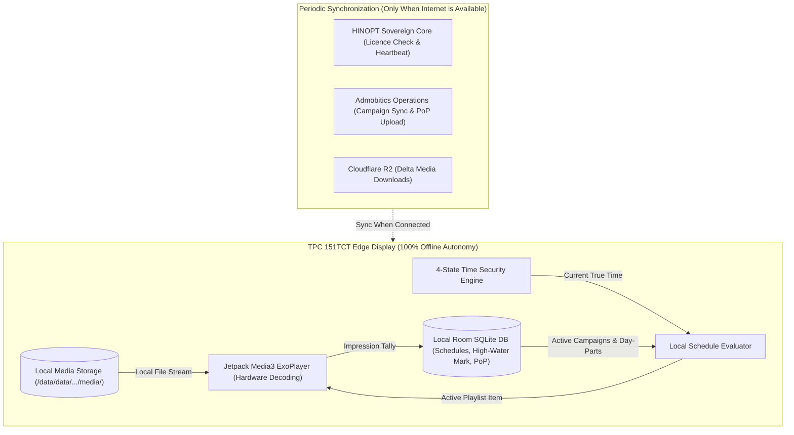
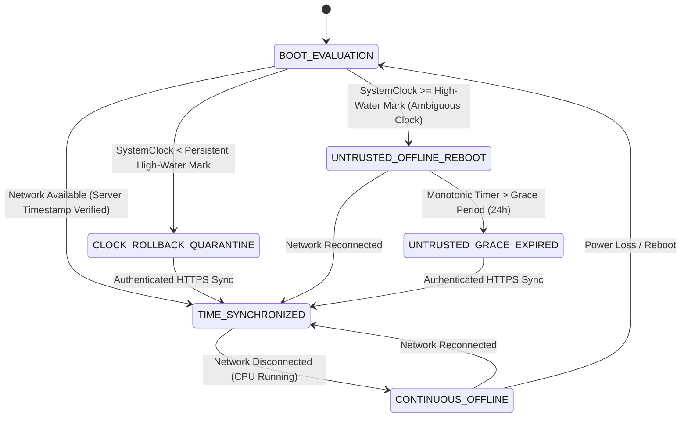
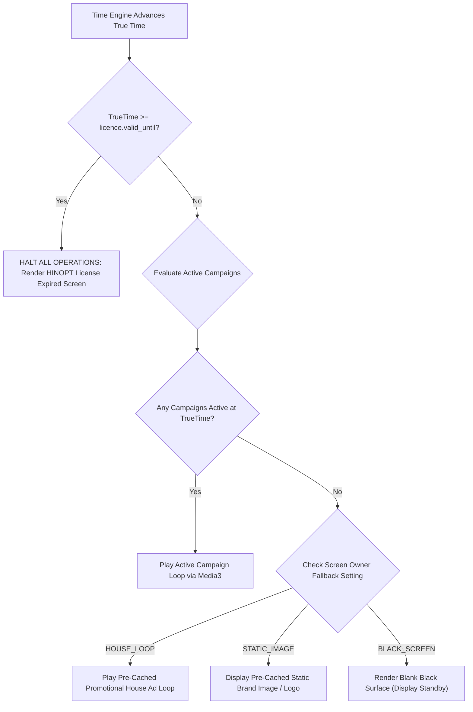

# PRD-004: Offline Resilience & 4-State Time Security Engine

**Document ID:** HINOPT-PRD-004  
**Project:** HINOPT Advertising Software  
**Version:** 1.0.0 (Phase 1 Baseline)  
**Status:** Ratified Specification  
**Classification:** Core Engineering Standard  
**Authors:** Principal Software Architect (HINOPT)  
**Stakeholders:** HINOPT Platform Engineering, Admobitics Operations  

---

## 1. Purpose & Scope

This specification establishes the architectural, algorithmic, and operational requirements for **Offline Autonomy** and **Time Security** within the **HINOPT Advertising Software** edge player running on the **TPC 151TCT** industrial display panel.

The HINOPT display player is strictly **offline-first**. Once initial campaign media and schedules are downloaded, the display operates continuously and indefinitely without requiring an internet connection. Network connectivity is utilized exclusively for periodic synchronization windows (downloading new campaigns, transmitting aggregated proof-of-play summaries, and refreshing software licences).

---

## 2. Offline-First Architecture & Local Playback Engine



### 2.1 Local Storage Hierarchy & Media Protection

1. **Storage Path:** All media files (MP4 video, images) reside in the application's private scoped internal storage:
   `/data/data/com.hinopt.player/files/media/{asset_id}.mp4`
2. **Offline Media Source:** Media3 uses `FileDataSource.Factory()` to read directly from local flash memory. No network sockets or HTTP streams are opened during active playback loops.
3. **Integrity Validation:** A media file is never added to the active playlist until its **SHA-256 hash** has been computed and verified against the backend sync manifest.
4. **Zero USB Ingress:** External USB mass storage auto-mounting is disabled via Android Device Policy Manager (`DISALLOW_MOUNT_PHYSICAL_MEDIA`). Media files can enter local storage solely through authenticated backend delivery.

---

## 3. The 4-State Time Security Engine

In digital signage, time is money. Advertisers pay for specific dates (e.g., Nov 1 to Nov 20). If a rogue operator unplugs the internet on Nov 19, rolls the device date back to Nov 10, and reboots, how does the player protect campaign expiry?

The **4-State Time Security Engine** solves this without requiring continuous internet.



### 3.1 State 1: `TIME_SYNCHRONIZED` (Connected Anchor)

- **Entry Condition:** Successful HTTPS response received from HINOPT or Admobitics API.
- **Clock Anchoring:** The display records two reference points:
  1. $T_{\text{server}}$: Authoritative UTC epoch timestamp parsed from the server's signed response payload or `Date` header.
  2. $E_{\text{anchor}}$: Current monotonic elapsed milliseconds from hardware (`SystemClock.elapsedRealtime()`).
- **Persistent High-Water Mark:** The display commits $T_{\text{server}}$ to the local Room database as the new **`high_water_mark`**.

### 3.2 State 2: `CONTINUOUS_OFFLINE` (Offline, CPU Running)

- **Entry Condition:** Network disconnects, but the device remains powered on.
- **Mathematical True Time:** Current True Time is calculated using the CPU hardware monotonic clock, which counts continuously even in low-power modes:
  $$\text{TrueTime}(t) = T_{\text{server}} + \left( \frac{\text{SystemClock.elapsedRealtime()} - E_{\text{anchor}}}{1000} \right)$$
- **Tamper Immunity:** Because the calculation relies strictly on elapsed milliseconds since boot, **manual changes to the Android system clock (`System.currentTimeMillis()`) or time zone adjustments have zero effect on playback scheduling**.
- **Continuous High-Water Mark Advance:** As playback progresses, the display periodically updates `high_water_mark` in Room SQLite every 10 minutes:
  $$\text{high\_water\_mark}_{\text{new}} = \max(\text{high\_water\_mark}_{\text{old}}, \text{TrueTime})$$

### 3.3 State 3: `UNTRUSTED_OFFLINE_REBOOT` (Offline Reboot, Ambiguous Clock)

- **Entry Condition:** The device reboots or loses power while offline ($E_{\text{anchor}}$ resets to 0).
- **Evaluation on Boot:** The player immediately reads `high_water_mark` from Room SQLite and compares it against `System.currentTimeMillis()`:
  - **Case A (Clock Rollback Detected):**  
    $$\text{System.currentTimeMillis()} < \text{high\_water\_mark}$$
    *Conclusion:* The clock was set backwards to a date prior to the last recorded playback event. **The engine immediately transitions to `CLOCK_ROLLBACK_QUARANTINE`.**
  - **Case B (Ambiguous Clock):**  
    $$\text{System.currentTimeMillis()} \ge \text{high\_water\_mark}$$
    *Conclusion:* The clock may be accurate or may have been pushed forward.
- **Untrusted Grace Period Ceiling:** The player enters a **24-hour monotonic grace window**:
  - The player continues rendering campaigns that were already valid at `high_water_mark`.
  - A monotonic timer (`SystemClock.elapsedRealtime()`) enforces that after 24 hours without network re-anchoring, the player transitions to `UNTRUSTED_GRACE_EXPIRED`.

### 3.4 State 4: `CLOCK_ROLLBACK_QUARANTINE` & `UNTRUSTED_GRACE_EXPIRED` (Safe Mode)

- **Action:** All commercial advertising playback is halted immediately.
- **Display Output:** The screen transitions to the owner-configured **Fallback Mode** (Promotional House Ad, Static Brand Image/Logo, or Black Screen).
- **Background Retry:** A background coroutine attempts an HTTPS handshake with exponential backoff ($60\text{s} \rightarrow 120\text{s} \rightarrow 300\text{s}$). Once internet is restored, the clock is re-anchored, and normal advertising playback resumes automatically.

---

## 4. Configurable Offline Licence Operating Policy

In accordance with our ratified product decisions, HINOPT administrators can configure the maximum offline duration for each display licence seat:

| Configuration Mode | Admin Policy | Offline Behavior |
| :--- | :--- | :--- |
| **Periodic Check-in Policy (Recommended)** | `max_offline_days: 30` (or 60, 90) | The display can run 100% offline for up to 30 continuous days. If 30 days elapse without a single internet check-in, the player pauses commercial ads until connected. |
| **Full Licence Duration Policy** | `max_offline_days: UNLIMITED` | The display can run 100% offline for the **entire duration of the purchased licence** (e.g., 365 days) without ever requiring an internet connection. |

### 4.1 Licence Token Claim

The offline operating limit is codified into the HINOPT Ed25519 signed licence token:

```json
{
  "sub": "d4e5f6a7-b8c9-4d0e-1f2a-3b4c5d6e7f8a",
  "valid_from": 1733011200,
  "valid_until": 1764547200,
  "offline_policy": {
    "max_offline_seconds": 2592000,
    "allow_full_licence_offline": false
  }
}
```

---

## 5. Decoupled Expiry & Empty Loop Resolution



### 5.1 The Expiry Separation Invariant

1. **Campaign Expiry:** Managed by Admobitics flight dates. When a campaign expires, it is dropped from the local loop. Other valid campaigns continue playing seamlessly.
2. **Empty Loop Fallback:** When all campaigns finish their booked flights, the player displays the **Screen Owner's choice** (Promotional House Ad, Static Logo/Image, or Black Screen).
3. **Licence Expiry:** Governed by the HINOPT master licence. If the software licence expires, the entire application halts and renders the HINOPT unlicenced screen.

---

## 6. Offline Proof-of-Play (PoP) Tallying & Delayed Upload

During offline operation, the display maintains aggregated summary counters in local Room SQLite:

```sql
CREATE TABLE local_pop_tallies (
    campaign_id TEXT NOT NULL,
    asset_id TEXT NOT NULL,
    calendar_date TEXT NOT NULL,         -- YYYY-MM-DD (Local Date)
    completed_plays INTEGER NOT NULL DEFAULT 0,
    total_seconds INTEGER NOT NULL DEFAULT 0,
    interrupted_plays INTEGER NOT NULL DEFAULT 0,
    last_played_at TEXT NOT NULL,
    PRIMARY KEY (campaign_id, asset_id, calendar_date)
);
```

### 6.1 Upload Policy (Configurable by Admin)

- **Offline Storage:** Tallies accumulate safely in local SQLite storage for weeks or months during network outages.
- **Upload Trigger:**
  - `DAILY_SUMMARY`: Whenever internet connectivity is detected, all un-uploaded daily summaries are batch-transmitted to `POST /v1/displays/{id}/playback-reports`.
  - `CAMPAIGN_DEADLINE`: Flushes summaries immediately upon the flight end date of each campaign.
- **Acknowledgement & Pruning:** Once the backend responds with **`202 Accepted`**, uploaded rows are safely deleted from local flash storage, keeping storage footprint under 5MB.

---

## 7. Physical Limitations & Engineering Truths

To maintain architectural integrity, the following physical limits of commercial ARMv8 hardware are explicitly acknowledged:

> [!WARNING]
> ### Limitations of Offline Time Security
> 1. **Lack of Hardware Secure RTC:** Standard commercial Android panels (including the TPC 151TCT) rarely feature a cryptographic, tamper-proof battery-backed Real-Time Clock.
> 2. **Reboot Vulnerability:** When a device is powered off, internal CPU counters (`elapsedRealtime()`) stop. If the device reboots while disconnected from the network, the OS relies on the motherboard RTC battery or default kernel build date.
> 3. **Tamper-Evident Guarantee:** The HINOPT system provides **tamper-evident rollback detection** (detecting any attempt to set the clock earlier than `high_water_mark`) and **monotonic pacing while running**, but **absolute tamper-proof offline expiry across an unpowered reboot without network is physically impossible without a verified hardware-backed cryptographic RTC**.

---

## 8. Requirements Traceability Matrix (PRD-004)

| Requirement ID | Description | Target Component | Verification Method |
| :--- | :--- | :--- | :--- |
| **PRD-004-REQ-01** | Continuous 100% offline playback from local flash storage | Media3 Engine | Physical Network Cable Disconnect Test |
| **PRD-004-REQ-02** | Monotonic true time calculation via `elapsedRealtime()` | Time Engine | OS Clock Modification Simulation |
| **PRD-004-REQ-03** | Persistent high-water mark logging every 10 minutes | Room SQLite DB | Unscheduled Power-Cut Stress Test |
| **PRD-004-REQ-04** | Immediate quarantine upon clock rollback detection | Time Engine | Manual Date Reversal Test |
| **PRD-004-REQ-05** | 24-hour untrusted grace period after offline reboot | Time Engine | Offline Reboot Simulation |
| **PRD-004-REQ-06** | Configurable offline licence duration (30/60 days or full year) | Licence Engine | Token Claim Validation Test |
| **PRD-004-REQ-07** | Screen owner fallback choice (House Ad, Logo, Black Screen) | Schedule Evaluator | Empty Loop Simulation |
| **PRD-004-REQ-08** | Offline PoP tallying in Room DB without data loss | Local PoP Tracker | 30-Day Simulated Run in Room |
| **PRD-004-REQ-09** | Automated PoP batch upload upon network reconnection | Background Sync | Connectivity Restoration Test |
| **PRD-004-REQ-10** | Zero USB media ingress enforcement via Device Policy Manager | Android Kiosk Policy | USB Mass Storage Insertion Test |

---

*HINOPT Advertising Software Specification — End of PRD-004*
